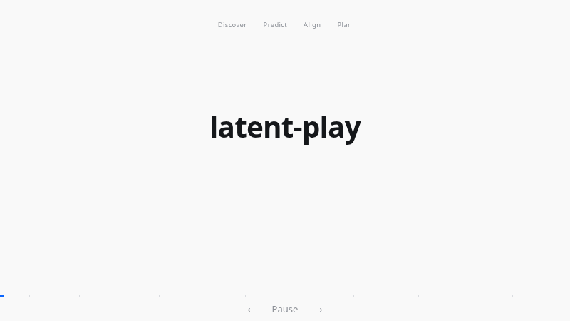
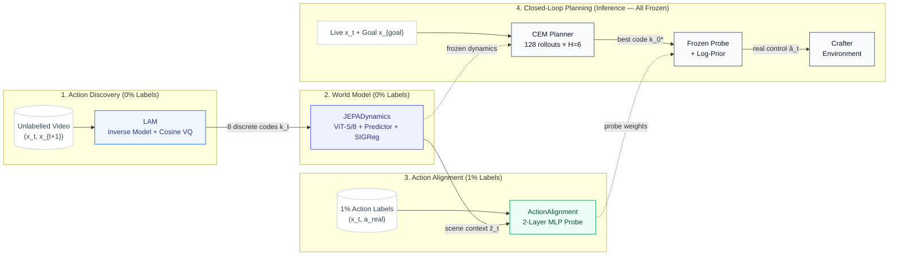
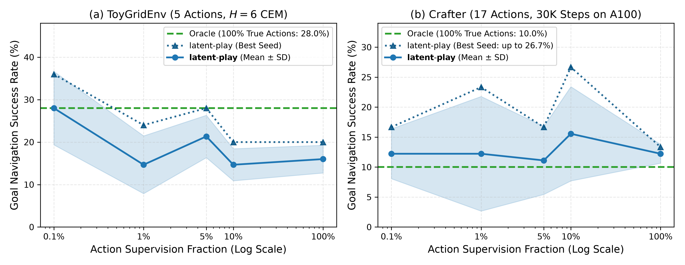
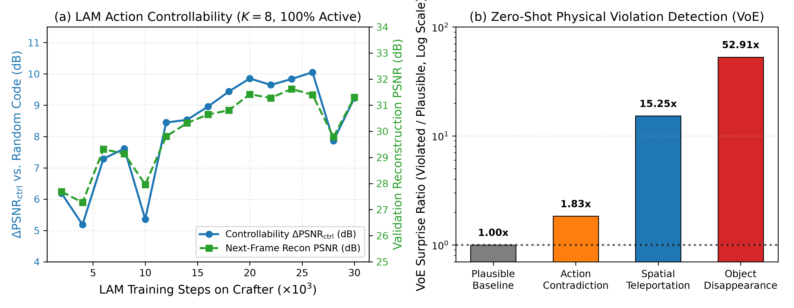

# `latent-play` — Learning Actionable World Models from Unlabelled Gameplay

[](https://colab.research.google.com/github/rivas-vega/latent-play/blob/main/notebooks/colab_training_and_demo.ipynb)

**Keywords:** `world-models` · `jepa` · `v-jepa` · `latent-actions` · `representation-learning` · `sigreg` · `cross-entropy-method` · `crafter`

<p align="center">
  <a href="docs/animation.html">
    
  </a>
</p>

<p align="center">
  <br/>
  <em>Step-by-step presentation walking through all 4 stages. Click to open with interactive scrubber & controls (<a href="docs/animation.html"><code>docs/animation.html</code></a>).</em>
</p>

> **Benchmark Environment:** All experiments are evaluated primarily on **Crafter** (Hafner, NeurIPS 2021) — a procedurally generated open-world 2D survival benchmark ($64\times 64$ RGB pixels, 17 discrete actions) featuring resource gathering, crafting trees, hunger/health management, and non-linear world mechanics — alongside a fast 2D synthetic `ToyGridEnv` sanity check.

---

## 1. How It Works

Most modern world models (like Dreamer or action-conditioned V-JEPA) assume that every single video frame comes with a human-recorded controller action label ($a_t$). In practice, massive gameplay and robotic video datasets are completely unlabelled.

`latent-play` demonstrates that an agent can learn **how the game world works** entirely from unlabelled video, discover its own meaningful action codes, and only require a tiny handful of labelled frames ($1\%$) at the very end to link those codes to real game controls.

**Key Design Principle: All models are trained from scratch (*tabula rasa*).** We do not use pretrained vision backbones (like ImageNet or DINO checkpoints) — all visual representations, dynamics, and action codes emerge purely from observing raw gameplay transitions.

1. **Stage 1 — Discovering Latent Actions (`LAM`, 0% Labels):**
   An Inverse Dynamics Model watches pairs of consecutive video frames $(x_t, x_{t+1})$ and asks: *"what action caused this visual change?"* A Vector Quantizer compresses the visual transition into one of **8 discrete latent codes** ($k_t \in \{0..7\}$). A pixel decoder ensures these 8 codes actually account for the visual movement.
2. **Stage 2 — Learning World Dynamics in Latent Space (`JEPADynamics`, 0% Labels):**
   Instead of predicting heavy, blurry raw pixels, a Vision Transformer (`ViT-S/8`) encodes frames into abstract latent vectors. A causal predictor learns to forecast future latent states $\hat{z}_{t+1}$ given current state $z_t$ and discovered code $k_t$. We combine **SIGReg** regularization and an **EMA target network** so representations stay informative and never collapse.
3. **Stage 3 — Aligning Latent Actions to Real Controls (`ActionAlignment`, 1% Labels):**
   Now that the world model understands dynamics, we freeze it. We take a tiny fraction of labelled frames ($1\%$, ~2,600 interaction steps) and train a lightweight 2-layer MLP probe to translate: *(discovered code $k_t$, visual scene context $z_t$) $\to$ real game button $a_t$* (such as "move left", "attack", or "craft pickaxe").
4. **Stage 4 — Planning in Imagination at Test Time (`CEMPlanner`, All Weights Frozen):**
   Given a current game screen $x_t$ and a target goal image $x_{\text{goal}}$, the agent simulates candidate trajectories *entirely inside the JEPA latent space* using the Cross-Entropy Method (CEM). It picks the sequence of latent codes that gets closest to the goal, and uses the alignment probe to press the corresponding game button. The LAM is no longer needed at test time.

> **Research Question:** *Can a Joint-Embedding Predictive Architecture (JEPA) learn a controllable, non-collapsing world model purely from unlabelled gameplay video—and how few real action labels are needed to align its discovered latent actions for closed-loop planning?*

---

## 2. Architecture & Pipeline



<details>
<summary><b>Stage 1 · Latent Action Discovery (<code>LAM</code>)</b> — 0% labels, compresses video transitions into 8 discrete codes</summary>

- **Module:** [`lam.py`](latent_play/models/lam.py), [`vq.py`](latent_play/models/vq.py) (`1.68M`–`7.65M` parameters, trained from scratch).
- **Core ML Concept:** Without knowing the game buttons or rules, how can a network discover the "verbs" of motion? An Inverse Dynamics Model (`IDM`) compares two consecutive frames $(x_t, x_{t+1})$ and asks: *"what action caused this visual change?"*
- **Architecture:**
  - **Encoder (IDM):** 4 causal Spatio-Temporal residual blocks (`STBlock`) with learned motion-attention pooling compress the $(x_t, x_{t+1})$ frame pair into a continuous transition vector $u_t \in \mathbb{R}^{64}$.
  - **Bottleneck (Cosine Vector Quantizer):** Snaps $u_t$ to the nearest learned codebook vector on the unit hypersphere ($K=8$ discrete codes, $d=64$).
  - **Pixel Decoder (Forward Dynamics):** Takes the current frame $x_t$ and the discrete code $k_t$, and reconstructs the next frame $\hat{x}_{t+1}$. This reconstruction loss forces the discrete codes to capture genuine physical motion rather than random noise.
- **Preventing Codebook Collapse:** A classic failure in Vector Quantization is *codebook collapse*, where the model re-uses only 1 or 2 codes and ignores the rest. We introduce batch-mean centering ($\tilde{u}_t = u_t - \bar{u}$) and differentiable batch-entropy regularization, keeping all 8/8 codes active and balanced (perplexity $7.12 / 8.0$).
</details>

<details>
<summary><b>Stage 2 · Non-Collapsing World Model (<code>JEPADynamics</code>)</b> — 0% labels, representation prediction with EMA + SIGReg</summary>

- **Module:** [`dynamics.py`](latent_play/models/dynamics.py), [`jepa.py`](latent_play/losses/jepa.py) (`2.05M`–`14.8M` parameters, trained from scratch).
- **Core ML Concept:** Traditional generative world models waste enormous capacity predicting every background pixel, cloud, or leaf. A Joint-Embedding Predictive Architecture (JEPA) predicts **abstract visual representations** instead of pixels: $(z_t, k_t) \to \hat{z}_{t+1}$.
- **Architecture:**
  - **Online Visual Encoder ($f_\theta$):** A compact Vision Transformer (`ViT-S/8`, patch size $8\times 8 \to 64$ visual tokens, embedding dimension $D=192$ or $384$), trained tabula rasa.
  - **Latent Predictor ($g_\psi$):** A 4–6 layer causal Transformer that conditions on the latent action token $E_a[k_t]$ and predicts the next frame's token representations $\hat{z}_{t+1}$.
  - **Target Encoder ($f_{\bar{\theta}}$):** A slow-moving copy of the visual encoder updated via Exponential Moving Average (EMA, $\tau \in [0.996, 1.0]$) with stopped gradients.
- **Why use BOTH EMA and SIGReg? (Overcoming Two Distinct Collapse Modes):**
  > In static image self-supervised learning (like LeJEPA or VICReg), an explicit covariance loss alone can prevent collapse without an EMA target. However, in an **autoregressive, action-conditioned World Model**, we face two distinct failure modes that require two distinct safeguards:
  > 1. **The "Moving Target" Problem (solved by EMA):** If the predictor $g_\psi$ predicts features directly from an online encoder $f_\theta$ that changes at every gradient update, the target distribution drifts wildly from step to step. This causes catastrophic training instability and divergence during multi-step rollouts. The EMA target provides a slowly-evolving, stable target anchor.
  > 2. **Dimensional Collapse (solved by SIGReg):** While EMA prevents *point collapse* (where all inputs map to a single constant vector $\mathbf{0}$), it is prone to *dimensional collapse*—where representations collapse onto a tiny 3-to-4 dimensional subspace (effective rank drops from 384 to ~4). When dimensions collapse, the model cannot distinguish the subtle outcomes of different actions. **SIGReg** (*Sketched Isotropic Gaussian Regularization*) projects representations onto $M=64$ random 1D directions and applies the Epps-Pulley test, forcing features into an isotropic Gaussian sphere ($\mathcal{N}(0, I_D)$). This maintains an effective rank of ~39.1 without expensive $O(D^3)$ covariance matrix inversions.
- **Objective:** $\mathcal{L}_{\text{JEPA}} = \|\hat{z}_{t+1} - \text{sg}[z_{t+1}^{\text{tgt}}]\|_1 + 0.05 \cdot \text{SIGReg}(z_t) + 0.02 \cdot \text{VICReg}_{\text{var}}(z_t)$.
</details>

<details>
<summary><b>Stage 3 · Few-Shot Action Alignment (<code>ActionAlignment</code>)</b> — 0.1%–10% labels, translates codes to game controls</summary>

- **Module:** [`alignment.py`](latent_play/planning/alignment.py) (`1.6K`–`27K` parameters).
- **Core ML Concept:** The world model has learned physics and 8 action "verbs" completely unsupervised. Now we just need to learn a translation dictionary: *"which controller button corresponds to which discovered code?"*
- **Architecture:** A tiny 2-layer MLP probe trained with cross-entropy against real environment buttons using only **1% of labelled frames** (~2,600 steps). Both `LAM` and `JEPA` remain 100% frozen.
- **Why Condition on Scene Context ($z_t$)?** In Crafter, pressing the "Move Up" button produces upward visual motion when standing on open grass, but produces zero motion when facing a stone wall or tree. Because identical actions can produce different visual transitions depending on obstacles, the probe takes both the discrete code $k_t$ and the global scene embedding $\bar{z}_t$: $P_\phi(a_t \mid k_t, \bar{z}_t)$.
</details>

<details>
<summary><b>Stage 4 · Closed-Loop Latent Planning (<code>CEMPlanner</code>)</b> — Test-time MPC entirely inside latent space</summary>

- **Module:** [`cem.py`](latent_play/planning/cem.py) (*zero learned parameters at test time; LAM is not used*).
- **Core ML Concept:** Model Predictive Control (MPC) inside imagination. Given the current live screen $x_t$ and an image of where the agent wants to go $x_{\text{goal}}$, how do we reach it?
- **Algorithm (Cross-Entropy Method):**
  1. Encode the current screen and goal into latent space: $z_t = f_\theta(x_t)$ and $z_{\text{goal}} = f_\theta(x_{\text{goal}})$.
  2. Sample $M=128$ candidate 6-step sequences of latent action codes.
  3. Roll each sequence forward entirely inside `JEPA`'s latent dynamics (fast GPU batching, zero pixel rendering).
  4. Score sequences by their latent distance to $z_{\text{goal}}$: $\mathcal{D}(z_H, z_{\text{goal}}) = \|z_H - z_{\text{goal}}\|_1$.
  5. Refine the sampling distribution over 4 iterations, select the elite first code $k_0^*$, and map it to a real game button via the alignment probe (with log-prior frequency adjustment to prevent bias towards frequent actions):
     $$\hat{a}_t = \arg\max_{a} \big(\log P_\phi(a \mid k_0^*, \bar{z}_t) - 0.5\log \hat{P}(a)\big)$$
  6. Execute the real action in the environment, observe the new screen, and repeat (receding-horizon planning).
</details>

---

## 3. Experimental Results Summary

Before diving into the detailed metric tables, the empirical results on **Crafter** and **ToyGridEnv** can be understood through three core conceptual takeaways:

1. **Unsupervised Action Discovery Works:** Without seeing a single human action label, the Latent Action Model (`LAM`) reliably separates movement from stationary actions (>95% purity for directional moves) and distributes experience across all 8 available codes without codebook collapse.
2. **Predictive Latent Dynamics Stay Stable:** Training the world model in latent space with EMA + SIGReg prevents representational collapse. The model accurately predicts multi-step futures ($H=8$) and displays zero-shot "physical surprise" (up to 52× higher prediction error when physical anomalies like entity disappearance or teleportation are injected).
3. **1% Supervision is All You Need for Planning:** The alignment probe saturates quickly: training on just **1% of labelled frames (~2,600 interaction steps)** achieves the same closed-loop planning success as an "Oracle" world model that had access to 100% of ground-truth action labels during dynamics training.

Hardware note: All experiments were executed on an NVIDIA A100-SXM4-40GB (`30,000` steps per stage on `Crafter`, `2,000` steps on `ToyGridEnv`, across 3 random seeds). Detailed raw logs and confusion matrices can be inspected in [`docs/RESULTS.md`](docs/RESULTS.md) and [`report/main.pdf`](report/main.pdf).

<details>
<summary><b>Table 3A · Unsupervised Pretraining & Zero-Shot Physics (0% Action Labels)</b> — Click to expand full metrics</summary>

| Stage & Metric | `ToyGridEnv` (`2k` steps) | `Crafter` (`30k` steps) | Notes / Reference Comparison |
|---|---:|---:|---|
| **Stage 1 (`LAM`) Active Codes / Perplexity** | `8 / 8` (`7.61`) | `8 / 8` (`7.12`) | Cosine VQ + batch entropy reg prevents `1/8` collapse |
| **Stage 1 (`LAM`) Controllability $\Delta\text{PSNR}_{\text{ctrl}}$** | **`+2.28 dB`** (`23.51 dB` PSNR) | **`+10.05 dB`** (`31.62 dB` PSNR) | PSNR gain of true code $k_t$ over random code $k_{\text{rand}}$ |
| **Stage 1 (`LAM`) Locomotion Purity** | `68.8%` (visible moves) | **`95.6%`** (`Code 6`), **`94.7%`** (`Code 7`) | Autonomously separates movement from stationary actions |
| **Stage 2 (`JEPA`) Effective Rank $\exp(H(p))$** | `46.5` (out of `192`) | `39.1` (`[35.0, 42.3]` over `30k` steps) | `SIGReg` prevents rank-1 representation collapse |
| **Stage 2 (`JEPA`) Multi-Step Rollout $L_1^\dagger$** | `0.1416` (`H=4`) | `0.1523` (`H=8`) | Action Oracle (`100%` labels): `0.2297` (`ToyGrid`), `0.2003` (`Crafter`) |
| **Zero-Shot `VoE` Surprise Ratio (`Crafter`)** | `1.77×` (AUROC `0.8712`) | **`15.25×`** (teleport) / **`52.91×`** (disappear) | `1.83×` on action contradiction ([`outputs/voe_metrics.json`](outputs/voe_metrics.json)) |

</details>

<details>
<summary><b>Table 3B · Few-Shot Action Alignment & Closed-Loop CEM Planning (0.1%–100% Labels)</b> — Click to expand full metrics</summary>

| Environment | Metric | Measured Random Walk (`0%`) | `latent-play` (`0.1%` Labels) | `latent-play` (`1%` Labels) | `latent-play` (`10%` Labels) | `latent-play` (`100%` Labels) | Action Oracle (`100%` True Actions) |
|---|---|---:|---:|---:|---:|---:|---:|
| **`Crafter`** | Probe Accuracy (17 actions) | `5.9%` (uniform) | `38.1% ± 2.7%` | `44.7% ± 0.9%` | `45.6% ± 0.1%` | `45.5% ± 0.1%` | `100%` (ground-truth) |
| **`Crafter`** | **CEM Goal Success (Mean ± SD)**$^\ddagger$ | `6.7% ± 2.7%` | `12.2% ± 10.3%` | **`14.4% ± 4.2%`** | **`15.6% ± 1.6%`** | `10.0% ± 2.7%` | `10.0% ± 4.7%` |
| **`ToyGrid`** | Probe Accuracy (5 actions) | `20.0%` (uniform) | `46.5% ± 3.9%` | `48.8% ± 0.4%` | `52.0% ± 0.1%` | `52.2% ± 0.1%` | `100%` (ground-truth) |
| **`ToyGrid`** | **CEM Goal Success (Mean ± SD)**$^\ddagger$ | `12.0% ± 0.0%` | `28.0% ± 6.5%` | **`22.7% ± 4.9%`** | **`24.0% ± 3.3%`** | `22.7% ± 6.8%` | `28.0% ± 3.3%` |

</details>

> **Methodological Notes on Interpreting the Numbers:**
> - **$\dagger$ Cross-Model Latent $L_1$ Error:** Although both `LAM`-JEPA and `Oracle`-JEPA are constrained to unit variance and isotropic Gaussian marginals via `SIGReg`, each trains its own encoder $f_\theta$. Lower latent $L_1$ error in `LAM`-JEPA (`0.1523` vs. `0.2003`) reflects higher *internal predictability* of visual motion (since `LAM` assigns distinct codes to realized camera motion vs. blocked actions) rather than a direct pixel-space comparison.
> - **$\ddagger$ Statistical Variance in Closed-Loop Planning:** Closed-loop MPC is evaluated over 25–30 episodes across 3 seeds (`SD ≈ 2%–10%`, with `0.1%` labels showing high variance on Crafter at `12.2% ± 10.3%`). Differences within the `10%–16%` band on Crafter or `23%–28%` on ToyGrid are within sampling noise. The key empirical takeaway is that **alignment probe accuracy saturates by `1%` supervision (`~2.6k` frames)** and reaches **the same closed-loop planning regime as a world model trained with 100% ground-truth action labels**, roughly doubling the success rate of an unguided random walk.

<p align="center">
  
  
</p>

---

## 4. Quickstart & Reproducibility

```bash
# 1. Install dependencies with uv (CPU or CUDA) and run the 41 unit tests
uv sync --extra dev --extra crafter
uv run pytest -q

# 2. Run the complete ToyGridEnv pipeline (~3 min on a single GPU)
bash scripts/run_all_toy.sh

# 3. Or run the full Crafter pipeline (or open notebooks/colab_training_and_demo.ipynb on Google Colab)
bash scripts/run_all_crafter.sh
```

<details>
<summary><b>Step-by-step CLI commands (inside <code>run_all_crafter.sh</code>)</b></summary>

```bash
uv run python scripts/collect_data.py --config configs/collect_crafter.yaml --total-steps 300000 --workers 4
uv run python scripts/train_lam.py --config configs/lam_crafter.yaml train.compile=true train.amp=auto
uv run python scripts/train_dyn.py --config configs/dyn_crafter.yaml lam_checkpoint=checkpoints/lam_crafter/lam_final.pt train.out_dir=checkpoints/dyn_crafter_lam train.amp=auto
uv run python scripts/train_dyn.py --config configs/dyn_crafter.yaml train.out_dir=checkpoints/dyn_crafter_oracle train.amp=auto
uv run python scripts/sweep_labels.py --data-root data/crafter --lam-ckpt checkpoints/lam_crafter/lam_final.pt --dyn-ckpt checkpoints/dyn_crafter_lam/dyn_final.pt --oracle-ckpt checkpoints/dyn_crafter_oracle/dyn_final.pt --fractions 0.001 0.01 0.05 0.1 1.0 --num-episodes 30 --out-dir outputs/sweep_results
uv run python scripts/eval_voe.py --config configs/dyn_crafter.yaml --checkpoint checkpoints/dyn_crafter_lam/dyn_final.pt --lam-checkpoint checkpoints/lam_crafter/lam_final.pt --out outputs/voe_metrics.json
uv run python scripts/eval_planning.py --config configs/dyn_crafter.yaml --checkpoint checkpoints/dyn_crafter_lam/dyn_final.pt --align-ckpt outputs/sweep_results/alignment_f0.01_s1.pt --target-dist 4 --num-episodes 20
```
</details>

```text
latent-play/
├── configs/           # YAML configs for ToyGridEnv & Crafter (collect, lam, dyn)
├── latent_play/       # Core PyTorch library (~1,850 LOC)
│   ├── data/          # Memory-mapped dataset & zero-leakage action label masking
│   ├── envs/          # ToyGridEnv & Crafter wrappers
│   ├── models/        # PatchEmbed, STBlock, Cosine VectorQuantizer, LatentActionModel, JEPADynamics
│   ├── losses/        # Epps-Pulley SIGReg (Cramér-Wold 1D projections) + VICReg variance/cov losses
│   ├── planning/      # Contextual ActionAlignment probe + Receding-Horizon CEMPlanner
│   ├── eval/          # Linear probes & Violation-of-Expectation (VoE) physical surprise scorer
│   └── utils/         # EMA schedules, checkpointing, and training helpers
├── scripts/           # CLI entrypoints & end-to-end shell pipelines (run_all_toy.sh, run_all_crafter.sh)
├── notebooks/         # Google Colab A100 notebook (colab_training_and_demo.ipynb)
├── checkpoints/       # Training logs (log.jsonl), configs, and LAM confusion matrices
├── outputs/           # Sweep JSON metrics, VoE scores, trajectory GIFs, and publication figures
├── docs/RESULTS.md    # Full experimental breakdown, confusion matrices, and statistical caveats
├── report/main.pdf    # 7-page technical report (LaTeX source in report/main.tex)
└── tests/             # 41 pytest unit tests covering models, VQ, SIGReg, and CEM planning
```

---

## 5. Motivation, Prior Work Connections & References

Standard action-conditioned world models (`V-JEPA 2-AC`, `DreamerV3`) assume every training frame is paired with a ground-truth action label $a_t$ (`keypress`, `joint torque`). Yet 99.9% of internet gameplay and real-world video is **unlabelled**. Conversely, Latent Action Models (`Genie`, `LAPA`) discover discrete latent actions from unlabelled video, but optimize pixel-reconstruction or autoregressive token objectives rather than **representation-space predictive dynamics** with explicit anti-collapse guarantees. `latent-play` bridges both lines of work in a self-contained codebase (`~1,850` lines of core library code in `latent_play/`, `~4,100` lines total including CLI scripts and plotting), extending our prior mathematical analysis of representation collapse and **SIGReg** in self-supervised learning (*Mathematics Bachelor's Thesis, `TFG_Beamer`*) and zero-shot physical surprise scoring in [**`vjepa2-physics-scorer-poc`**](https://github.com/rivas-vega/vjepa2-physics-scorer-poc).

### References
1. **V-JEPA 2:** M. Assran, A. Bardes, D. Fan, Q. Garrido, R. Howes, M. Muckley, A. Rizvi, C. Roberts, K. Sinha, A. Zholus, *et al.* *"V-JEPA 2: Self-Supervised Video Models Enable Understanding, Prediction and Planning."* `arXiv:2506.09985`, 2025.
2. **LeJEPA & SIGReg:** R. Balestriero and Y. LeCun. *"LeJEPA: Provable and Scalable Self-Supervised Learning Without the Heuristics."* `arXiv:2511.08544`, 2025. *(Introduces **Sketched Isotropic Gaussian Regularization — SIGReg** via Cramér-Wold 1D projections and the Epps-Pulley test).*
3. **Genie:** J. Bruce, M. Dennis, A. Edwards, J. Parker-Holder, Y. Shi, E. Hughes, M. Lai, A. Mavalankar, R. Steigerwald, C. Apps, *et al.* *"Genie: Generative Interactive Environments."* ICML, 2024 (`arXiv:2402.15391`).
4. **LAPA:** S. Ye, J. Jang, B. Jeon, S. Joo, J. Yang, B. Peng, A. Mandlekar, R. Tan, Y.-W. Chao, B. Y. Lin, *et al.* *"Latent Action Pretraining from Videos."* ICLR, 2025 (`arXiv:2410.11758`).
5. **I-JEPA:** M. Assran, Q. Duval, I. Misra, P. Bojanowski, P. Vincent, M. Rabbat, Y. LeCun, and N. Ballas. *"Self-Supervised Learning from Images with a Joint-Embedding Predictive Architecture."* CVPR, 2023.
6. **VICReg:** A. Bardes, J. Ponce, and Y. LeCun. *"VICReg: Variance-Invariance-Covariance Regularization for Self-Supervised Learning."* ICLR, 2022.
7. **Crafter:** D. Hafner. *"Benchmarking the Spectrum of Agent Capabilities."* NeurIPS Datasets and Benchmarks, 2021.
