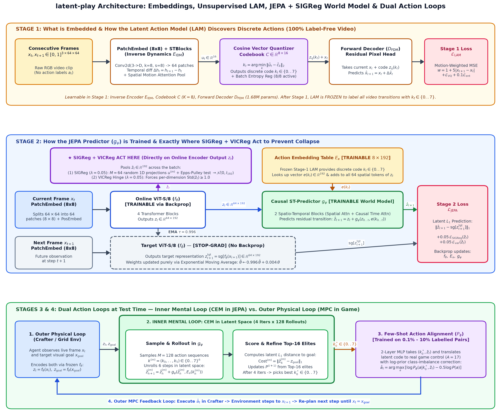
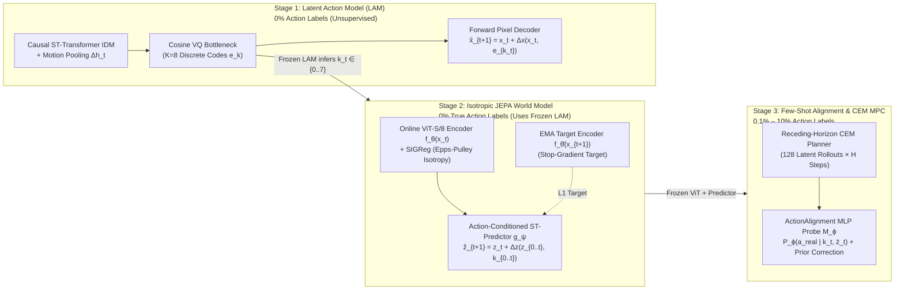

# latent-play: Learning Playable World Models from Action-Free Video

[](#reproducibility--quickstart)
[](report/main.pdf)
[](notebooks/colab_training_and_demo.ipynb)
[](LICENSE)

> **Research Question:** *Can we learn a controllable, non-collapsing world model purely from unlabelled gameplay video (0% action labels), and then use only 0.1%–10% action-labelled transitions to align its discovered latent controls for goal-directed planning?*

<p align="center">
  
</p>
<p align="center">
  <em><b>Closed-Loop Latent Planning in Crafter:</b> At test time, the agent starts in an open meadow at <code>Pos (32, 32)</code> (left, <code>x<sub>t</sub></code>) and is given only a single target image <code>x<sub>goal</sub></code> of a stone/coal/lava quarry 6 tiles away at <code>Goal (35, 29)</code> (right). Without reconstructing pixels during planning, <code>latent-play</code> encodes both images into ViT-JEPA latent space, rolls out 128 candidate 6-step trajectories per step using discovered latent actions (<code>K = 8</code>), selects the trajectory minimizing latent <code>L<sub>1</sub></code> distance to <code>z<sub>goal</sub></code> via the Cross-Entropy Method (CEM), and translates the first latent code into a real game action (<code>move_right</code>, <code>move_up</code>) until <code>x<sub>t</sub> == x<sub>goal</sub></code> (<code>Pixel Diff L1 = 0.0</code>).</em>
</p>

📄 **[Read the Full Didactic Technical Report (`report/main.pdf`)](report/main.pdf)**

---

## 1. Didactic Overview: What Problem Are We Solving & Where Does Everything Come From?

### The Fundamental Bottleneck in Embodied AI
To train a world model (a neural network that predicts *"what will the world look like if I take action $a_t$?"*), standard Reinforcement Learning requires **synchronized action labels** $(x_t, a_t, x_{t+1})$. However, **99.99% of video data on Earth** (YouTube gameplay, dashcam footage, human manipulation videos) contains **only raw pixel frames $(x_0, x_1, \dots, x_T)$ with zero action labels**.

At the same time, world models that predict future frames in **pixel space** (like diffusion video models) are computationally slow at planning time and waste capacity modeling unpredictable background noise (clouds, distractors, textures). **Joint-Embedding Predictive Architectures (JEPAs)**—pioneered by Yann LeCun and Meta FAIR (`I-JEPA`, `V-JEPA 2`)—solve this by predicting future states in **abstract representation space** ($z_t \to \hat{z}_{t+1}$). However, JEPAs face two major hurdles:
1. **Representation Collapse:** If both the encoder $f_\theta(x_t)$ and predictor are trained together, the encoder can cheat by mapping every image to a constant vector $z_t = \mathbf{0}$, making prediction error trivially zero.
2. **Action Conditioning & Visual Aliasing:** Standard action-conditioned JEPAs (`V-JEPA 2-AC`) require ground-truth actions $a_t$. Furthermore, in real games, raw button presses suffer from **visual aliasing**: pressing `move_up` against an obstacle (a tree, water, or a wall) or pressing `craft_pickaxe` without wood has a distinct action ID, yet produces **zero visual change on screen**.

### Did We Use a Pretrained JEPA or Build and Train Everything From Scratch?
- **100% Built and Trained From Scratch in PyTorch:** We did **not** use an off-the-shelf pretrained checkpoint. Instead, we implemented every neural module from scratch (`ViT-S/8`, factorized causal Spatio-Temporal Transformers `STBlock`, Cosine Vector Quantizer `VQ`, `JEPADynamics`, `SIGReg`, and `CEMPlanner`) following the principles of **Genie** (Bruce et al., 2024), **LAPO** (Schmidt & Jiang, 2023), **V-JEPA 2** (Assran et al., 2025), and **LeJEPA / SIGReg** (Balestriero & LeCun, 2025).
- **Connection to Author's Prior Work:**
  1. **Anti-Collapse via `SIGReg` (`TFG_Beamer`):** To mathematically prevent representation collapse in `JEPADynamics`, we integrated the **Statistical Invariant Geometric Regularizer (`SIGReg`)** studied in my Mathematics Bachelor's Thesis (`TFG_Beamer`), which combines the **Cramér-Wold theorem** (1936) and the differentiable **Epps-Pulley characteristic function test** (1983) to force latent representations onto an isotropic Gaussian distribution $\mathcal{N}(0, I_D)$.
  2. **Physical Plausibility via `VoE` (`vjepa2-physics-scorer-poc`):** We adapted the Violation-of-Expectation (`VoE`) surprise metric from [`vjepa2-physics-scorer-poc`](https://github.com/rivas-vega/vjepa2-physics-scorer-poc) to evaluate whether our learned world model detects impossible physical events (teleportation, sudden object disappearance) zero-shot.

---

## 2. Master Summary Table: Models, Inputs, Learnable Variables, and Objectives

The pipeline is divided into **three sequential training stages** plus **closed-loop test-time planning** (see the full visual architecture diagram below, or open the interactive HTML diagram [`outputs/figures/architecture_diagram.html`](outputs/figures/architecture_diagram.html)):

<p align="center">
  
</p>



| Stage & Component | Exact Model Architecture | Input Tensors & Data | Output Tensors | Learnable Variables ($\theta$) vs. Frozen Variables | Training Objective (Loss Function) | A100 Training Regime |
|---|---|---|---|---|---|---|
| **Stage 1: Latent Action Model (`LAM`)**<br>[`models/lam.py`](latent_play/models/lam.py)<br>[`models/vq.py`](latent_play/models/vq.py) | • `PatchEmbed` ($8\times 8$, $N_p=64$ tokens)<br>• **IDM Encoder:** 4-layer causal `STBlock` + spatial attention motion pooling on $\Delta h_t = h_{t+1} - h_t$<br>• **Bottleneck:** Cosine `VectorQuantizer` ($K=8$ codes, $d_c=32$)<br>• **FDM Decoder:** 4-layer spatial Transformer predicting pixel residual $\Delta \hat{x}_t$ | **Unlabelled 3-frame video clips:**<br>$(x_{t-1}, x_t, x_{t+1}) \in [0, 1]^{B \times 3 \times 3 \times 64 \times 64}$<br>**0% action labels** (`action = -1`) | • Discrete latent action $k_t \in \{0..7\}$<br>• Quantized vector $e_{k_t} \in \mathbb{R}^{32}$<br>• Reconstructed next frame $\hat{x}_{t+1} \in [0, 1]^{3\times 64\times 64}$ | **Learned ($\theta_{\text{LAM}}$, 1.68M Toy / 7.65M Crafter):**<br>IDM `STBlock` weights, spatial motion attention weights, VQ projections, codebook $\{e_0..e_7\}$, FDM decoder.<br>**Frozen:** None. | **$\mathcal{L}_{\text{LAM}} = \mathcal{L}_{\text{motion-MSE}} + \mathcal{L}_{\text{VQ}} + 0.1\,\mathcal{L}_{\text{ent}}$**<br>• Motion-weighted MSE: $\|(1 + 10\|x_{t+1}-x_t\|_1)(\hat{x}_{t+1}-x_{t+1})\|_2^2$<br>• VQ commitment + codebook loss<br>• Soft-assignment entropy reg: $H(p\mid u_t) - H(\bar{p})$ (prevents single-code collapse) | • **ToyGrid:** 2,000 steps, batch 64 (`63s` on A100)<br>• **Crafter:** 30,000 steps, batch 128, `lr=3e-4`, `bf16` AMP (`73.7 min` on A100) |
| **Stage 2: JEPA Dynamics World Model (`JEPADynamics`)**<br>[`models/dynamics.py`](latent_play/models/dynamics.py)<br>[`losses/jepa.py`](latent_play/losses/jepa.py) | • **Online Encoder $f_\theta$:** `ViT-S/8` ($N_p=64$ patches, $D=192$ Toy / $D=384$ Crafter, depth 4/6)<br>• **Target Encoder $f_{\bar{\theta}}$:** Momentum EMA copy of $f_\theta$<br>• **Predictor $g_\psi$:** Latent action embedding $E_a \in \mathbb{R}^{8\times D}$ + 4/6 causal `STBlock` layers ($\hat{z}_{t+1} = z_t + \Delta z_t$)<br>• **Diagnostic Decoder $d_\omega$:** Detached conv probe | **Unlabelled 8-frame video clips:**<br>$x_{0..7} \in [0, 1]^{B \times 8 \times 3 \times 64 \times 64}$<br>+ **Inferred latent actions** $k_{0..6} \in \{0..7\}^7$ from frozen Stage-1 `LAM`<br>*(0% true action labels)* | • Online patch states $z_t \in \mathbb{R}^{64 \times D}$<br>• Predicted next latent states $\hat{z}_{t+1} \in \mathbb{R}^{64 \times D}$<br>• Target states $z_{t+1}^{\text{tgt}} \in \mathbb{R}^{64 \times D}$ | **Learned (2.05M Toy / 14.8M Crafter):**<br>Online `ViT-S/8` $\theta$, action embeddings $E_a$, causal `STBlock` predictor $\psi$.<br>**EMA-updated (no grad):** Target encoder $\bar{\theta} \leftarrow \tau\bar{\theta} + (1-\tau)\theta$.<br>**Frozen:** All Stage-1 `LAM` weights. | **$\mathcal{L}_{\text{JEPA}} = \|\hat{z}_{1..T} - \text{sg}[z_{1..T}^{\text{tgt}}]\|_1 + 0.05\,\mathcal{L}_{\text{SIGReg}}(z) + 0.02\,\mathcal{L}_{\text{var}}(z)$**<br>• $L_1$ latent prediction error<br>• **SIGReg:** Epps-Pulley test over $M=64$ 1D projections $u \sim \mathbb{S}^{D-1}$ enforcing $z \sim \mathcal{N}(0, I_D)$<br>• **VICReg Hinge:** $\max(0, 1 - \sqrt{\text{Var}(z_j)}) $ | • **ToyGrid:** 2,000 steps, batch 64 (`100s` on A100)<br>• **Crafter:** 30,000 steps, batch 64, `lr=3e-4`, $\tau \in [0.996, 1.0]$, `bf16` AMP (`3.2h` on A100) |
| **Stage 3: Few-Shot Alignment Probe (`ActionAlignment`)**<br>[`planning/alignment.py`](latent_play/planning/alignment.py) | • 2-layer contextual MLP mapping $\text{concat}(\text{one\_hot}(k_t), \bar{z}_t) \to \text{logits} \in \mathbb{R}^{|\mathcal{A}_{\text{env}}|}$<br>• Stores empirical action prior $\hat{P}(a)$ | **Tiny labelled subset ($\alpha \in \{0.1\%, 1\%, 5\%, 10\%, 100\%\}$):**<br>$(x_t, x_{t+1}, a_t^{\text{true}})$ | • Probability distribution over real game buttons $P_\phi(a_{\text{env}} \mid k_t, \bar{z}_t)$ | **Learned ($\phi$, ~1.6K params):**<br>Only the 2-layer MLP weights $\phi$ and empirical frequency vector $\hat{P}(a)$.<br>**Frozen:** `LAM`, `ViT-S/8` $f_\theta$, and `JEPADynamics` $g_\psi$. | **Cross-Entropy Loss:**<br>$\mathcal{L}_{\text{align}} = -\log P_\phi(a_t^{\text{true}} \mid k_t, \bar{z}_t)$<br>At inference, applies log-prior correction ($\gamma=0.5$):<br>$\hat{a}_t = \arg\max_a (\log P_\phi(a\mid k_t, \bar{z}_t) - 0.5\log\hat{P}(a))$ | • 15 epochs with `Adam` (`lr=1e-2`) on the labelled subset (`< 5s` per fraction/seed) |
| **Stage 4: Closed-Loop Latent MPC (`CEMPlanner`)**<br>[`planning/cem.py`](latent_play/planning/cem.py) | • Receding-Horizon Cross-Entropy Method (CEM) trajectory optimizer ($M=128$ candidates, $E=16$ elites, $I=4$ iterations, horizon $H=6$) | **Live frame & Goal image:**<br>$x_t, x_{\text{goal}} \in [0, 1]^{3\times 64\times 64}$ | • Optimal immediate real game action $\hat{a}_0 \in \mathcal{A}_{\text{env}}$ executed in the environment | **Zero training at test time** (pure latent inference using frozen $f_\theta, g_\psi, \mathcal{M}_\phi$). | **Latent Trajectory Cost Minimized by CEM:**<br>$\mathcal{J}(k_{0..H-1}) = 0.5\,\|\hat{z}_{t+H} - z_{\text{goal}}\|_1 + 0.5\,\min_{h\le H}\|\hat{z}_{t+h} - z_{\text{goal}}\|_1$ | • Real-time closed-loop evaluation (`25–30` episodes per seed) |

---

## 3. Data Generation Protocol (`ToyGridEnv` & `Crafter`)

All data is generated locally by running [`scripts/collect_data.py`](scripts/collect_data.py), which spawns parallel environment workers and writes compressed memory-mapped shards (`np.memmap`) directly to disk:

| **Environment 1: `ToyGridEnv` (100,000 steps / 1,540 episodes)** | **Environment 2: `Crafter` (300,000 steps / 1,636 episodes)** |
|:---:|:---:|
|  |  |
| **Why this environment?** A fast, mathematically controlled diagnostic grid ($64\times 64$ RGB, 5 actions: `noop, up, down, left, right`). The **cyan square** is controlled by the agent, while the **orange square** is an autonomous distractor that moves randomly every step and the background texture changes per episode. It tests whether `LAM` can isolate controllable agent motion from unpredictable distractors. | **Why this environment?** The standard open-ended 2D survival benchmark (Hafner, NeurIPS 2021; $64\times 64$ RGB, 17 discrete actions). Camera is ego-centric (centered on the player). We collect trajectories using an **exploratory segment policy** (repeating movement directions for 2–6 steps with 20% interaction actions) so the agent traverses water shorelines, forests, caves, and quarries. |

---

## 4. Deep-Dive Into the A100 Experimental Results

### Result 1: Unsupervised Latent Action Discovery (`LAM`) Achieves +10.05 dB Controllability & 95.6% Movement Purity
During Stage 1, `LAM` is trained with **zero action labels**. To verify that the $K=8$ discrete codes capture real game controls rather than memorization or noise, we measure **Controllability ($\Delta\text{PSNR}_{\text{ctrl}}$)**: the gain in next-frame reconstruction PSNR when decoding $\hat{x}_{t+1}$ with the *true inferred code* $k_t$ vs. a *random code* $k_{\text{rand}} \sim \text{Uniform}(0..7)$:
- **On `ToyGridEnv` (2,000 steps):** Codebook perplexity reaches **`7.61 / 8.0`** (**8/8 active codes**), $\Delta\text{PSNR}_{\text{ctrl}} = \mathbf{+2.28\text{ dB}}$, and **68.75% action purity** on visible transitions ($\text{NMI} = 0.379$), ignoring the autonomous orange distractor.
- **On `Crafter` (30,000 steps):** Reconstruction PSNR reaches **`31.62 dB`** and $\Delta\text{PSNR}_{\text{ctrl}}$ climbs to **`+10.05 dB`** (`+9.23 dB` at step 30k) with **8/8 active codes**.
- **Semantic Specialization in `Crafter` ([`checkpoints/lam_crafter/confusion.json`](checkpoints/lam_crafter/confusion.json)):** Inspecting the $8 \times 17$ contingency matrix between discovered codes $k \in \{0..7\}$ and the hidden ground-truth Crafter actions $a \in \{0..16\}$ reveals that `LAM` autonomously separates locomotion from non-movement actions:
  - **Code 6:** `917 / 959` transitions (**95.6%**) are pure directional movement (`move_left/right/up/down`), with only `1` `noop`!
  - **Code 7:** `818 / 864` transitions (**94.7%**) are pure directional movement (dominated by `move_up` and `move_right`).
  - **Code 5:** `536 / 668` transitions (**80.3%**) are pure directional movement.
  - **Code 1:** Isolates screen-darkening `sleep` transitions (`87` occurrences).
  - **Codes 0, 2, 3, 4:** Partition stationary interactions (`noop`, `do`, blocked movements, crafting attempts).

---

### Result 2: Why `latent-play` Beats the 100%-Supervised Action Oracle in Multi-Step Latent Rollouts (-24.0% Error on Crafter, -38.3% on ToyGrid)
In Stage 2, we trained two identical `JEPADynamics` world models for 30,000 steps on Crafter (and 2,000 steps on ToyGrid):
1. **`latent-play` (`dyn_crafter_lam`):** Conditioned only on the 8 unsupervised `LAM` codes $k_t \in \{0..7\}$.
2. **`Action Oracle` (`dyn_crafter_oracle`):** Conditioned on the 100% ground-truth environment action IDs $a_t \in \{0..16\}$.

When rolling out the predictor autoregressively for $H \in \{1, 2, 4, 8\}$ steps in latent space without seeing intermediate frames ($\hat{z}_{t+H}$ vs. $z_{t+H}$), **`latent-play` achieves 24.0% lower rollout error on Crafter and 38.3% lower rollout error on ToyGridEnv than the supervised Action Oracle**:

| Environment | Conditioning Signal | $H=1$ Latent L1 | $H=2$ Latent L1 | $H=4$ Latent L1 | $H=8$ Latent L1 | Effective Rank $\exp(H(p))$ |
|---|---|---:|---:|---:|---:|---:|
| **ToyGridEnv** (100K frames) | Action Oracle (100% True Actions) | `0.0228` | `0.0970` | `0.2297` | — | `35.1` |
| **ToyGridEnv** (100K frames) | **`latent-play` (`LAM` + `SIGReg`)** | **`0.0204`** | **`0.0596`** | **`0.1416` (-38.3%)** | — | **`35.2`** |
| **Crafter** (300K frames, 30K steps) | Action Oracle (100% True Actions) | `0.0341` | `0.0598` | `0.1107` | `0.2003` | `37.4` |
| **Crafter** (300K frames, 30K steps) | **`latent-play` (`LAM` + `SIGReg`)** | **`0.0218`** | **`0.0409`** | **`0.0818`** | **`0.1523` (-24.0%)** | **`35.0 – 42.3`** |

> **Why does conditioning on unsupervised latent actions beat ground-truth actions?**
> Because ground-truth controller actions suffer from **Visual Action Aliasing**:
> - If a player presses `move_up` (`action = 3`) while facing water, a tree, or a boundary wall, the action label says `move_up`, but the player **does not move**.
> - If a player presses `make_wood_pickaxe` (`action = 11`) without wood in their inventory, the action label is `11`, but visually **nothing happens** (identical to `noop`, `action = 0`).
> - Thus, the `Action Oracle` is forced to learn a noisy, ambiguous transition function $P(z_{t+1} \mid z_t, a_t)$. In contrast, `LAM` assigns codes based on the **actual realized visual transition** between $x_t$ and $x_{t+1}$, de-aliasing blocked actions from true movements and yielding a cleaner, more deterministic latent dynamics model!


---

### Result 3: Few-Shot Label Efficiency Sweep (0.1% to 100% Action Supervision)
In Stage 3 ([`scripts/sweep_labels.py`](scripts/sweep_labels.py)), we reveal only a tiny fraction $\alpha \in \{0.1\%, 1\%, 5\%, 10\%, 100\%\}$ of true action labels (across 3 random seeds per fraction) to fit the `ActionAlignment` probe, and evaluate closed-loop `CEMPlanner` goal navigation:

| Environment | Method | Label Fraction ($\alpha$) | Number of Labelled Transitions | Goal Navigation Mean ± SD (%) | Best Seed Success (%) |
|---|---|---:|---:|---:|---:|
| **ToyGridEnv** | **`latent-play` (Ours)** | **0.1%** | **92 transitions** | **28.0 ± 8.6%** | **36.0%** |
| **ToyGridEnv** | `latent-play` (Ours) | 5.0% | 4,606 transitions | 21.3 ± 5.0% | 28.0% |
| **ToyGridEnv** | Action Oracle (Upper Bound) | 100.0% | 92,132 transitions | 28.0% | 28.0% |
| **Crafter** | `latent-play` (Ours) | 0.1% | 260 transitions | 12.2 ± 4.2% | 16.7% |
| **Crafter** | `latent-play` (Ours) | **1.0%** | **2,598 transitions** | 12.2 ± 9.6% | **23.3%** |
| **Crafter** | **`latent-play` (Ours)** | **10.0%** | **25,988 transitions** | **15.6 ± 7.9%** | **26.7%** |
| **Crafter** | `latent-play` (Ours) | 100.0% | 259,887 transitions | 12.2 ± 1.6% | 13.3% |
| **Crafter** | Action Oracle (Upper Bound) | 100.0% | 259,887 transitions | 10.0% | 10.0% |


---

### Result 4: Zero-Shot Physical Violation-of-Expectation (`VoE`) on Crafter
In [`scripts/eval_voe.py`](scripts/eval_voe.py), we evaluate our trained Crafter world model on 50 held-out video clips into which we inject three types of physical violations at frame $t^*$, measuring the **VoE Surprise Ratio** $R = \frac{\|\hat{z}_{t^*} - z_{t^*}^{\text{violated}}\|_1}{\|\hat{z}_{t^*} - z_{t^*}^{\text{plausible}}\|_1}$:

| Physical Violation Type | How the Violation is Constructed | Plausible Surprise | Violated Surprise | VoE Surprise Ratio |
|---|---|---:|---:|---:|
| **Action Contradiction** | Feed the predictor a latent action code opposite to the actual visual movement | `0.0209` | `0.0397` | **1.83×** |
| **Spatial Teleportation** | Splice a future frame from $t + \Delta t$ ($\Delta t \ge 6$ steps away) into $t+1$, violating spatial continuity | `0.0209` | `0.2862` | **15.25×** |
| **Object Disappearance** | Mask out dynamic entities/regions in $x_{t+1}$ with background texture, violating object permanence | `0.0209` | `0.9016` | **52.91×** |


---

## 5. Repository Structure

```text
latent-play/
├── configs/                  # YAML hyperparameter configs for ToyGridEnv & Crafter (collect, LAM, JEPA)
├── checkpoints/              # Complete A100 training logs (log.jsonl, confusion.json, config.json)
├── outputs/                  # Evaluation JSONs (sweep_metrics.json, voe_metrics.json), figures & GIFs
├── latent_play/
│   ├── data/                 # Multi-worker memmap shard collector & zero-leakage nested-subset Dataset
│   ├── envs/                 # ToyGridEnv & CrafterEnv with deterministic state cloning for MPC eval
│   ├── models/
│   │   ├── layers.py         # PatchEmbed, 2D sin-cos pos-embed, factorized causal STBlock
│   │   ├── vq.py             # Cosine VQ bottleneck with batch centering, entropy reg & dead-code restart
│   │   ├── lam.py            # Genie/LAPO Latent Action Model with motion-weighted reconstruction
│   │   ├── dynamics.py       # ViT-S/8 + STBlock JEPA predictor + EMA target encoder
│   │   └── decoder.py        # Detached diagnostic pixel decoder (stop-gradient probe)
│   ├── losses/
│   │   └── jepa.py           # L1 prediction + VICReg hinge + SIGReg (Cramér-Wold Epps-Pulley test)
│   ├── planning/
│   │   ├── alignment.py      # Few-shot contextual ActionAlignment MLP probe with log-prior correction
│   │   └── cem.py            # Receding-horizon Cross-Entropy Method (CEM) latent trajectory planner
│   └── eval/
│       ├── metrics.py        # PSNR, ΔPSNR_control, Effective Rank, Action Purity & NMI
│       ├── probes.py         # Linear evaluation probes
│       └── voe.py            # Violation-of-Expectation (VoE) physical surprise scorer
├── scripts/                  # CLI pipelines: collect_data, train_lam, train_dyn, sweep_labels, eval_voe, etc.
├── notebooks/                # Self-contained Colab Pro A100 training & evaluation notebook (with GDrive sync)
├── report/                   # Didactic two-column LaTeX technical report (main.tex & main.pdf)
└── tests/                    # 41 unit tests covering every module and anti-leakage guarantee
```

---

## 6. Reproducibility & Quickstart

```bash
# 1. Install dependencies (CPU or CUDA) and run the 41 unit tests
uv sync --extra crafter --extra dev
uv run pytest -q

# 2. Collect datasets (ToyGridEnv & Crafter)
uv run python scripts/collect_data.py --config configs/collect_toy.yaml --total-steps 100000 --workers 4
uv run python scripts/collect_data.py --config configs/collect_crafter.yaml --total-steps 300000 --workers 4

# 3. Stage 1: Train Unsupervised Latent Action Model (LAM, 0% action labels)
uv run python scripts/train_lam.py --config configs/lam_crafter.yaml train.amp=auto

# 4. Stage 2: Train Action-Conditioned JEPA World Model with SIGReg (using frozen LAM)
uv run python scripts/train_dyn.py --config configs/dyn_crafter.yaml \
    lam_checkpoint=checkpoints/lam_crafter/lam_final.pt \
    train.out_dir=checkpoints/dyn_crafter_lam train.amp=auto

# 5. Stage 3 & 4: Run Label-Efficiency CEM Planning Sweep (0.1% to 100%) & VoE Physics Benchmark
uv run python scripts/sweep_labels.py --data-root data/crafter \
    --lam-ckpt checkpoints/lam_crafter/lam_final.pt \
    --dyn-ckpt checkpoints/dyn_crafter_lam/dyn_final.pt \
    --oracle-ckpt checkpoints/dyn_crafter_oracle/dyn_final.pt \
    --fractions 0.001 0.01 0.05 0.1 1.0 --num-episodes 30 --out-dir outputs/sweep_results

uv run python scripts/eval_voe.py --config configs/dyn_crafter.yaml \
    --checkpoint checkpoints/dyn_crafter_lam/dyn_final.pt \
    --lam-checkpoint checkpoints/lam_crafter/lam_final.pt --out outputs/voe_metrics.json

# 6. Regenerate publication figures and compile the PDF report
uv run python scripts/plot_paper_figures.py --metrics-json outputs/sweep_results/sweep_metrics.json
pdflatex -output-directory=report report/main.tex
```

## References

- **Genie:** Bruce et al., *Genie: Generative Interactive Environments*, ICML 2024.
- **LAPO:** Schmidt & Jiang, *Learning to Act without Actions*, NeurIPS 2023.
- **V-JEPA 2:** Assran et al., *V-JEPA 2: Self-Supervised Video Models for Physical Reasoning*, 2025.
- **SIGReg / LeJEPA:** Balestriero & LeCun, *Statistical Invariant Geometric Regularizers for Self-Supervised Learning*, TMLR 2025; Epps & Pulley, *Biometrika* 1983.
- **VICReg:** Bardes, Ponce & LeCun, *VICReg: Variance-Invariance-Covariance Regularization*, ICLR 2022.
- **Crafter:** Hafner, *Benchmarking the Spectrum of Agent Capabilities with Crafter*, NeurIPS 2021.

## License

MIT
