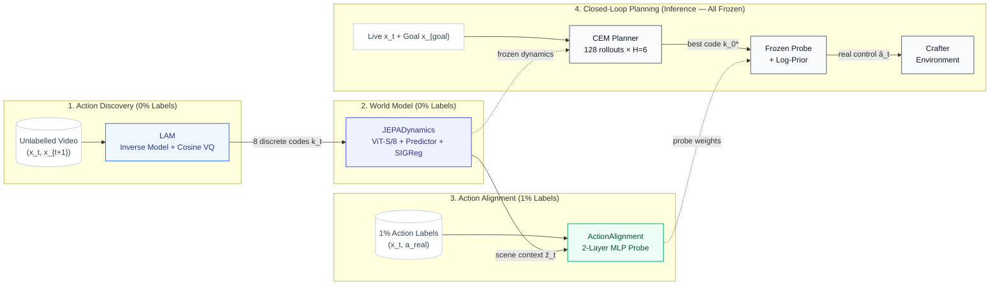

# `latent-play` — Learning Actionable World Models from Unlabelled Gameplay

[](https://github.com/rivas-vega/latent-play/actions/workflows/ci.yml)
[](https://www.python.org/)
[](https://pytorch.org/)
[](LICENSE)
[](https://colab.research.google.com/github/rivas-vega/latent-play/blob/main/notebooks/colab_training_and_demo.ipynb)

**Keywords:** `world-models` · `jepa` · `v-jepa` · `latent-actions` · `representation-learning` · `sigreg` · `cross-entropy-method` · `crafter`

<p align="center">
  <a href="docs/animation.html">
    
  </a>
</p>

<p align="center">
  <br/>
  <em>Step-by-step presentation walking through all 4 stages. Click to open with interactive scrubber & controls (<a href="docs/animation.html"><code>docs/animation.html</code></a>).</em>
</p>

---

## 1. How It Works

`latent-play` separates **learning how the world changes** (from 100% unlabelled video) from **learning what the controller buttons are called** (from a tiny labelled subset):

1. **Stage 1 — Latent Action Model (`LAM`, Training, 0% labels):** An inverse-forward model watches consecutive video frames $(x_t, x_{t+1})$ and compresses whatever caused the visual transition into one of **$K=8$ discrete latent action codes** $k_t \in \{0..7\}$ via a Cosine Vector Quantizer (`VQ`).
2. **Stage 2 — Isotropic JEPA World Model (`JEPADynamics`, Training, 0% labels):** With `LAM` frozen as a pseudo-labeler, a `ViT-S/8` encoder and causal Spatio-Temporal predictor learn to predict the next frame's latent representation $\hat{z}_{t+1}$ from $(z_t, k_t)$, regularized by **SIGReg** (*Sketched Isotropic Gaussian Regularization*) so representations never collapse.
3. **Stage 3 — Few-Shot Action Alignment (`ActionAlignment`, Training, 0.1%–10% labels):** With both `LAM` and `JEPA` frozen, a lightweight 2-layer MLP (`~1.6K`–`27K` parameters) learns to translate `(latent code k_t, scene embedding z̄_t) → real environment action a_t` using a small handful of labelled frames.
4. **Stage 4 — Closed-Loop Latent MPC (`CEMPlanner`, Test-Time Inference, all weights frozen):** At test time, **`LAM` is no longer needed**. Given live frame $x_t$ and goal image $x_{\text{goal}}$, `CEM` searches over sequences of the **8 latent codes** entirely inside `JEPA`'s latent space, picks the best first code $k_0^*$, and passes it to `ActionAlignment` to execute a real game action.

> **Research Question:** *Can a Joint-Embedding Predictive Architecture (JEPA) learn a controllable, non-collapsing world model purely from unlabelled gameplay video—and how few real action labels are needed to align its discovered latent actions for closed-loop planning?*

---

## 2. Architecture & Pipeline



<details>
<summary><b>Stage 1 · Latent Action Discovery (<code>LAM</code>)</b> — 0% labels, compresses video transitions into 8 discrete codes</summary>

- **Module:** [`lam.py`](latent_play/models/lam.py), [`vq.py`](latent_play/models/vq.py) (`1.68M`–`7.65M` parameters).
- **Input → Output:** Consecutive video frames $(x_t, x_{t+1}) \to$ discrete code $k_t \in \{0..7\}$ + reconstructed $\hat{x}_{t+1}$.
- **Architecture:** Inverse Dynamics (`IDM`) encoder with 4 causal Spatio-Temporal (`STBlock`) layers, learned spatial motion-attention pooling, Cosine Vector Quantizer (`CosineVQ`), and motion-weighted Forward Dynamics (`FDM`) pixel decoder.
- **Objective:** $\mathcal{L}_{\text{LAM}} = \mathcal{L}_{\text{pixel}} + \mathcal{L}_{\text{commit}} + \mathcal{L}_{\text{entropy}}$ (batch-mean centering $\tilde{u}_t = u_t - \bar{u}$ and differentiable batch-entropy regularization prevent codebook collapse, keeping all 8/8 codes active).
</details>

<details>
<summary><b>Stage 2 · Non-Collapsing World Model (<code>JEPADynamics</code>)</b> — 0% labels, representation prediction with SIGReg</summary>

- **Module:** [`dynamics.py`](latent_play/models/dynamics.py), [`jepa.py`](latent_play/losses/jepa.py) (`2.05M`–`14.8M` parameters).
- **Input → Output:** Current frame $x_t$ + frozen `LAM` code $k_t \to$ predicted next latent representation $\hat{z}_{t+1} \in \mathbb{R}^{64\times D}$.
- **Architecture:** Online `ViT-S/8` encoder $f_\theta$, action embedding table $E_a \in \mathbb{R}^{8\times D}$, 4–6 layer causal spatio-temporal predictor $g_\psi$, and target encoder $f_{\bar{\theta}}$ updated via Exponential Moving Average (EMA, $\tau \in [0.996, 1.0]$) with stop-gradient.
- **Objective & Anti-Collapse:** Predicts representations directly without pixel reconstruction:
  $$\mathcal{L}_{\text{JEPA}} = \|\hat{z}_{t+1} - \text{sg}[z_{t+1}^{\text{tgt}}]\|_1 + 0.05 \cdot \text{SIGReg}(z_t) + 0.02 \cdot \text{VICReg}_{\text{var}}(z_t)$$
  `SIGReg` projects online representations onto $M=64$ random 1D unit directions via the **Epps-Pulley** characteristic test, driving representations to an isotropic Gaussian $\mathcal{N}(0, I_D)$ without $O(D^3)$ covariance inversion.
</details>

<details>
<summary><b>Stage 3 · Few-Shot Action Alignment (<code>ActionAlignment</code>)</b> — 0.1%–10% labels, translates codes to game controls</summary>

- **Module:** [`alignment.py`](latent_play/planning/alignment.py) (`1.6K`–`27K` parameters).
- **Input → Output:** Inferred code $k_t \in \{0..7\}$ + scene context embedding $\bar{z}_t \in \mathbb{R}^D \to$ distribution over real controls $P_\phi(a \mid k_t, \bar{z}_t)$.
- **Architecture:** Lightweight 2-layer MLP probe trained on just `0.1%–10%` of labelled interaction frames while `LAM` and `JEPA` remain completely frozen.
- **Objective:** Cross-entropy against ground-truth game controls. Context conditioning resolves identical visual transitions produced in different surroundings (e.g., walking into an obstacle vs. open terrain).
</details>

<details>
<summary><b>Stage 4 · Closed-Loop Latent Planning (<code>CEMPlanner</code>)</b> — Test-time MPC entirely inside latent space</summary>

- **Module:** [`cem.py`](latent_play/planning/cem.py) (*zero learned parameters at test time*).
- **Input → Output:** Current frame $x_t$ + goal image $x_{\text{goal}} \to$ executed environment action $\hat{a}_t$.
- **Algorithm:** Cross-Entropy Method (`CEM`). Encodes $z_t = f_\theta(x_t)$ and $z_{\text{goal}} = f_\theta(x_{\text{goal}})$. Over $I=4$ iterations, evaluates $M=128$ candidate 6-step latent sequences entirely inside `JEPA` latent space, minimizes $L_1$ latent distance to $z_{\text{goal}}$, selects the elite first code $k_0^*$, and executes real game control with log-prior frequency correction:
  $$\hat{a}_t = \arg\max_{a} \big(\log P_\phi(a \mid k_0^*, \bar{z}_t) - 0.5\log \hat{P}(a)\big)$$
</details>

---

## 3. Experimental Results Summary

All experiments were executed on an NVIDIA A100-SXM4-40GB (`30,000` steps per stage on `Crafter`, `2,000` steps on `ToyGridEnv`, 3 evaluation seeds). Full breakdowns and confusion matrices are in **[`docs/RESULTS.md`](docs/RESULTS.md)** and **[`report/main.pdf`](report/main.pdf)**.

### 3A. Unsupervised Pretraining & Zero-Shot Physics (`Stages 1 & 2 — 0% Action Labels`)

| Stage & Metric | `ToyGridEnv` (`2k` steps) | `Crafter` (`30k` steps) | Notes / Reference Comparison |
|---|---:|---:|---|
| **Stage 1 (`LAM`) Active Codes / Perplexity** | `8 / 8` (`7.61`) | `8 / 8` (`7.12`) | Cosine VQ + batch entropy reg prevents `1/8` collapse |
| **Stage 1 (`LAM`) Controllability $\Delta\text{PSNR}_{\text{ctrl}}$** | **`+2.28 dB`** (`23.51 dB` PSNR) | **`+10.05 dB`** (`31.62 dB` PSNR) | PSNR gain of true code $k_t$ over random code $k_{\text{rand}}$ |
| **Stage 1 (`LAM`) Locomotion Purity** | `68.8%` (visible moves) | **`95.6%`** (`Code 6`), **`94.7%`** (`Code 7`) | Autonomously separates movement from stationary actions |
| **Stage 2 (`JEPA`) Effective Rank $\exp(H(p))$** | `46.5` (out of `192`) | `39.1` (`[35.0, 42.3]` over `30k` steps) | `SIGReg` prevents rank-1 representation collapse |
| **Stage 2 (`JEPA`) Multi-Step Rollout $L_1^\dagger$** | `0.1416` (`H=4`) | `0.1523` (`H=8`) | Action Oracle (`100%` labels): `0.2297` (`ToyGrid`), `0.2003` (`Crafter`) |
| **Zero-Shot `VoE` Surprise Ratio (`Crafter`)** | `1.77×` (AUROC `0.8712`) | **`15.25×`** (teleport) / **`52.91×`** (disappear) | `1.83×` on action contradiction ([`outputs/voe_metrics.json`](outputs/voe_metrics.json)) |

### 3B. Few-Shot Action Alignment & Closed-Loop CEM Planning (`Stages 3 & 4`)

| Environment | Metric | Measured Random Walk (`0%`) | `latent-play` (`0.1%` Labels) | `latent-play` (`1%` Labels) | `latent-play` (`10%` Labels) | `latent-play` (`100%` Labels) | Action Oracle (`100%` True Actions) |
|---|---|---:|---:|---:|---:|---:|---:|
| **`Crafter`** | Probe Accuracy (17 actions) | `5.9%` (uniform) | `38.1% ± 2.7%` | `44.7% ± 0.9%` | `45.6% ± 0.1%` | `45.5% ± 0.1%` | `100%` (ground-truth) |
| **`Crafter`** | **CEM Goal Success (Mean ± SD)**$^\ddagger$ | `6.7% ± 2.7%` | `12.2% ± 10.3%` | **`14.4% ± 4.2%`** | **`15.6% ± 1.6%`** | `10.0% ± 2.7%` | `10.0% ± 4.7%` |
| **`ToyGrid`** | Probe Accuracy (5 actions) | `20.0%` (uniform) | `46.5% ± 3.9%` | `48.8% ± 0.4%` | `52.0% ± 0.1%` | `52.2% ± 0.1%` | `100%` (ground-truth) |
| **`ToyGrid`** | **CEM Goal Success (Mean ± SD)**$^\ddagger$ | `12.0% ± 0.0%` | `28.0% ± 6.5%` | **`22.7% ± 4.9%`** | **`24.0% ± 3.3%`** | `22.7% ± 6.8%` | `28.0% ± 3.3%` |

> **Methodological Notes on Interpreting the Numbers:**
> - **$\dagger$ Cross-Model Latent $L_1$ Error:** Although both `LAM`-JEPA and `Oracle`-JEPA are constrained to unit variance and isotropic Gaussian marginals via `SIGReg`, each trains its own encoder $f_\theta$. Lower latent $L_1$ error in `LAM`-JEPA (`0.1523` vs. `0.2003`) reflects higher *internal predictability* of visual motion (since `LAM` assigns distinct codes to realized camera motion vs. blocked actions) rather than a direct pixel-space comparison.
> - **$\ddagger$ Statistical Variance in Closed-Loop Planning:** Closed-loop MPC is evaluated over 25–30 episodes across 3 seeds (`SD ≈ 2%–10%`, with `0.1%` labels showing high variance on Crafter at `12.2% ± 10.3%`). Differences within the `10%–16%` band on Crafter or `23%–28%` on ToyGrid are within sampling noise. The key empirical takeaway is that **alignment probe accuracy saturates by `1%` supervision (`~2.6k` frames)** and reaches **the same closed-loop planning regime as a world model trained with 100% ground-truth action labels**, roughly doubling the success rate of an unguided random walk.

<p align="center">
  
  
</p>

---

## 4. Quickstart & Reproducibility

```bash
# 1. Install dependencies with uv (CPU or CUDA) and run the 41 unit tests
uv sync --extra dev --extra crafter
uv run pytest -q

# 2. Run the complete ToyGridEnv pipeline (~3 min on a single GPU)
bash scripts/run_all_toy.sh

# 3. Or run the full Crafter pipeline (or open notebooks/colab_training_and_demo.ipynb on Google Colab)
bash scripts/run_all_crafter.sh
```

<details>
<summary><b>Step-by-step CLI commands (inside <code>run_all_crafter.sh</code>)</b></summary>

```bash
uv run python scripts/collect_data.py --config configs/collect_crafter.yaml --total-steps 300000 --workers 4
uv run python scripts/train_lam.py --config configs/lam_crafter.yaml train.compile=true train.amp=auto
uv run python scripts/train_dyn.py --config configs/dyn_crafter.yaml lam_checkpoint=checkpoints/lam_crafter/lam_final.pt train.out_dir=checkpoints/dyn_crafter_lam train.amp=auto
uv run python scripts/train_dyn.py --config configs/dyn_crafter.yaml train.out_dir=checkpoints/dyn_crafter_oracle train.amp=auto
uv run python scripts/sweep_labels.py --data-root data/crafter --lam-ckpt checkpoints/lam_crafter/lam_final.pt --dyn-ckpt checkpoints/dyn_crafter_lam/dyn_final.pt --oracle-ckpt checkpoints/dyn_crafter_oracle/dyn_final.pt --fractions 0.001 0.01 0.05 0.1 1.0 --num-episodes 30 --out-dir outputs/sweep_results
uv run python scripts/eval_voe.py --config configs/dyn_crafter.yaml --checkpoint checkpoints/dyn_crafter_lam/dyn_final.pt --lam-checkpoint checkpoints/lam_crafter/lam_final.pt --out outputs/voe_metrics.json
uv run python scripts/eval_planning.py --config configs/dyn_crafter.yaml --checkpoint checkpoints/dyn_crafter_lam/dyn_final.pt --align-ckpt outputs/sweep_results/alignment_f0.01_s1.pt --target-dist 4 --num-episodes 20
```
</details>

```text
latent-play/
├── configs/           # YAML configs for ToyGridEnv & Crafter (collect, lam, dyn)
├── latent_play/       # Core PyTorch library (~1,850 LOC)
│   ├── data/          # Memory-mapped dataset & zero-leakage action label masking
│   ├── envs/          # ToyGridEnv & Crafter wrappers
│   ├── models/        # PatchEmbed, STBlock, Cosine VectorQuantizer, LatentActionModel, JEPADynamics
│   ├── losses/        # Epps-Pulley SIGReg (Cramér-Wold 1D projections) + VICReg variance/cov losses
│   ├── planning/      # Contextual ActionAlignment probe + Receding-Horizon CEMPlanner
│   ├── eval/          # Linear probes & Violation-of-Expectation (VoE) physical surprise scorer
│   └── utils/         # EMA schedules, checkpointing, and training helpers
├── scripts/           # CLI entrypoints & end-to-end shell pipelines (run_all_toy.sh, run_all_crafter.sh)
├── notebooks/         # Google Colab A100 notebook (colab_training_and_demo.ipynb)
├── checkpoints/       # Training logs (log.jsonl), configs, and LAM confusion matrices
├── outputs/           # Sweep JSON metrics, VoE scores, trajectory GIFs, and publication figures
├── docs/RESULTS.md    # Full experimental breakdown, confusion matrices, and statistical caveats
├── report/main.pdf    # 7-page technical report (LaTeX source in report/main.tex)
└── tests/             # 41 pytest unit tests covering models, VQ, SIGReg, and CEM planning
```

---

## 5. Motivation, Prior Work Connections & References

Standard action-conditioned world models (`V-JEPA 2-AC`, `DreamerV3`) assume every training frame is paired with a ground-truth action label $a_t$ (`keypress`, `joint torque`). Yet 99.9% of internet gameplay and real-world video is **unlabelled**. Conversely, Latent Action Models (`Genie`, `LAPA`) discover discrete latent actions from unlabelled video, but optimize pixel-reconstruction or autoregressive token objectives rather than **representation-space predictive dynamics** with explicit anti-collapse guarantees. `latent-play` bridges both lines of work in a self-contained codebase (`~1,850` lines of core library code in `latent_play/`, `~4,100` lines total including CLI scripts and plotting), extending our prior mathematical analysis of representation collapse and **SIGReg** in self-supervised learning (*Mathematics Bachelor's Thesis, `TFG_Beamer`*) and zero-shot physical surprise scoring in [**`vjepa2-physics-scorer-poc`**](https://github.com/rivas-vega/vjepa2-physics-scorer-poc).

### References
1. **V-JEPA 2:** M. Assran, A. Bardes, D. Fan, Q. Garrido, R. Howes, M. Muckley, A. Rizvi, C. Roberts, K. Sinha, A. Zholus, *et al.* *"V-JEPA 2: Self-Supervised Video Models Enable Understanding, Prediction and Planning."* `arXiv:2506.09985`, 2025.
2. **LeJEPA & SIGReg:** R. Balestriero and Y. LeCun. *"LeJEPA: Provable and Scalable Self-Supervised Learning Without the Heuristics."* `arXiv:2511.08544`, 2025. *(Introduces **Sketched Isotropic Gaussian Regularization — SIGReg** via Cramér-Wold 1D projections and the Epps-Pulley test).*
3. **Genie:** J. Bruce, M. Dennis, A. Edwards, J. Parker-Holder, Y. Shi, E. Hughes, M. Lai, A. Mavalankar, R. Steigerwald, C. Apps, *et al.* *"Genie: Generative Interactive Environments."* ICML, 2024 (`arXiv:2402.15391`).
4. **LAPA:** S. Ye, J. Jang, B. Jeon, S. Joo, J. Yang, B. Peng, A. Mandlekar, R. Tan, Y.-W. Chao, B. Y. Lin, *et al.* *"Latent Action Pretraining from Videos."* ICLR, 2025 (`arXiv:2410.11758`).
5. **I-JEPA:** M. Assran, Q. Duval, I. Misra, P. Bojanowski, P. Vincent, M. Rabbat, Y. LeCun, and N. Ballas. *"Self-Supervised Learning from Images with a Joint-Embedding Predictive Architecture."* CVPR, 2023.
6. **VICReg:** A. Bardes, J. Ponce, and Y. LeCun. *"VICReg: Variance-Invariance-Covariance Regularization for Self-Supervised Learning."* ICLR, 2022.
7. **Crafter:** D. Hafner. *"Benchmarking the Spectrum of Agent Capabilities."* NeurIPS Datasets and Benchmarks, 2021.
