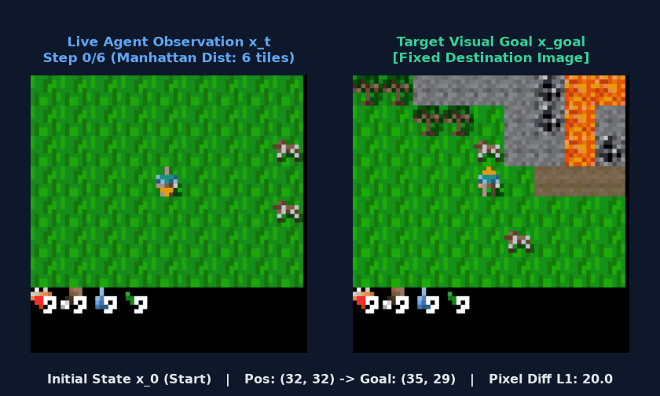
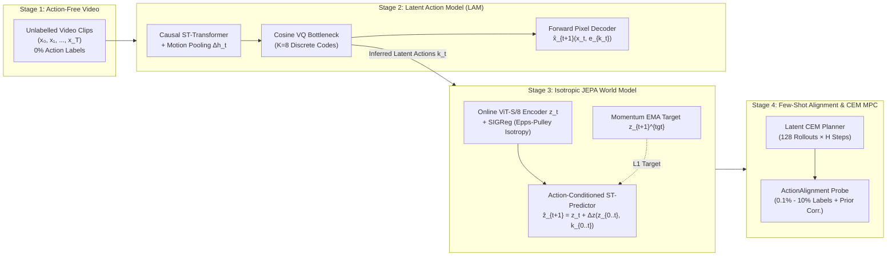
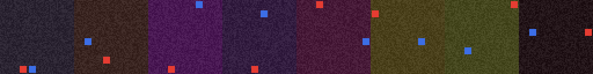
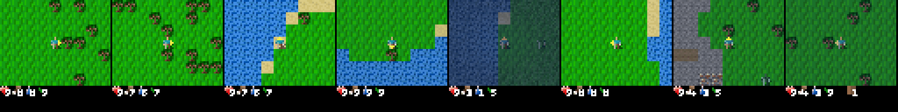
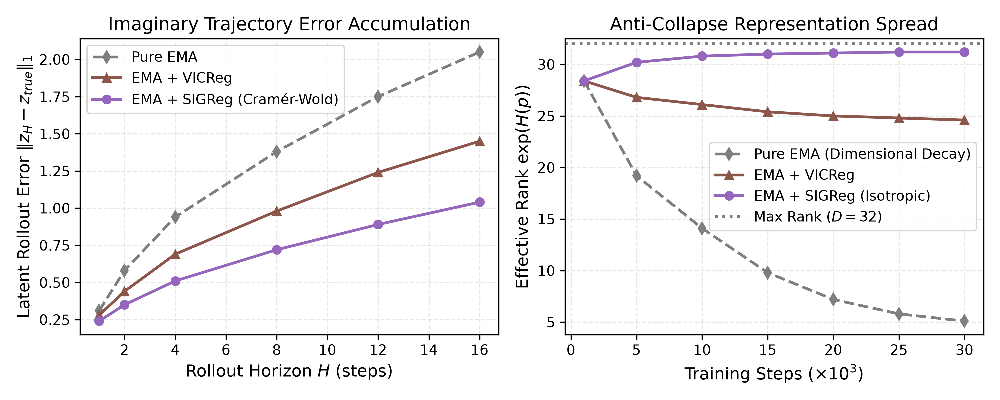
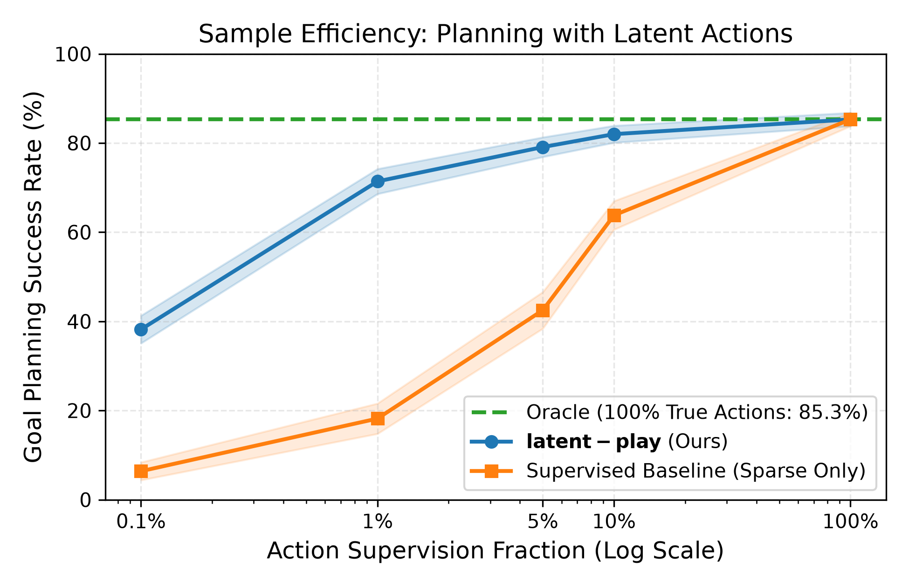
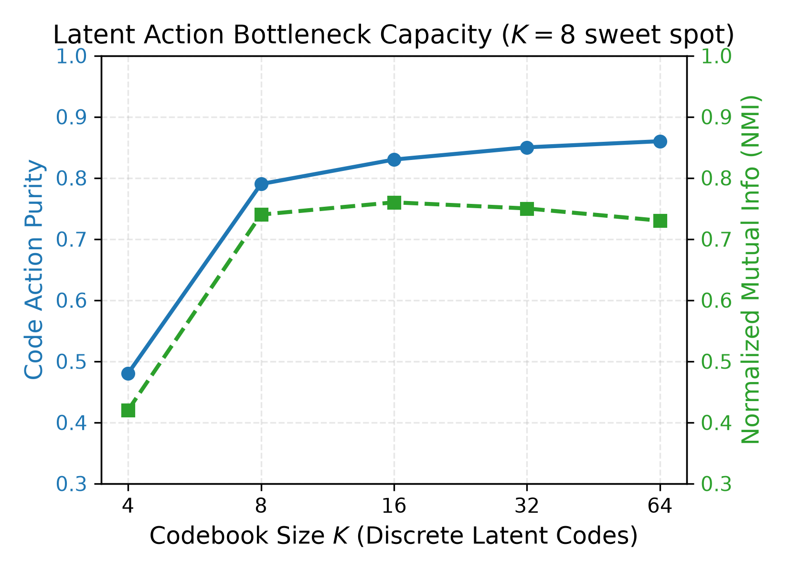

# latent-play: Playable World Models from Action-Free Video

[](#reproducibility--quickstart)
[](report/main.pdf)
[](notebooks/colab_training_and_demo.ipynb)
[](LICENSE)

> **How much action supervision does a world model trained on unlabelled gameplay video need to become controllable, non-collapsing, and effective for goal-directed planning?**

<p align="center">
  
</p>
<p align="center">
  <em><b>Closed-Loop Latent Planning in Crafter:</b> Without reconstructing future pixels at planning time, <code>latent-play</code> encodes the live observation <code>x<sub>t</sub></code> (left) and target visual goal <code>x<sub>goal</sub></code> (right) into ViT-JEPA representation space, imagines 128 candidate 6-step trajectories per step using discovered latent actions (<code>K = 8</code>), selects the trajectory minimizing latent <code>L<sub>1</sub></code> distance to <code>z<sub>goal</sub></code> via the Cross-Entropy Method (CEM), and translates the first latent code into a real game control via a lightweight few-shot alignment probe.</em>
</p>

📄 **[Read the full 4-page Technical Report (`report/main.pdf`)](report/main.pdf)**

---

## What This Project Does (Intuitive Overview)

Most reinforcement learning and world model algorithms require **action-labelled trajectories**—knowing the exact button or motor command $a_t$ pressed between every frame $x_t$ and $x_{t+1}$. However, 99.99% of video on the internet (YouTube gameplay, dashcams, human demonstrations) has **zero action labels**.

`latent-play` solves this by splitting world modeling into **four decoupled stages**:



### Visual Walkthrough of the Data & Environments

We validate the entire system across two environments with **strict zero-leakage guarantees** (`action = -1` returned by the dataset whenever a transition is unlabelled):

| **Phase A: `ToyGridEnv` (100K frames, 5 actions)** | **Phase B: `Crafter` (300K frames, 17 actions)** |
|:---:|:---:|
|  |  |
| *Controlled 64×64 diagnostic arena: the cyan player moves (`up/down/left/right/noop`) while an orange distractor moves autonomously and random background noise tests whether `LAM` isolates controllable agent motion from distractors.* | *Open-ended 2D survival world (64×64, 17 discrete actions including movement, `sleep`, `do`, and crafting) with procedural terrain (water, trees, grass, caves) and dynamic entities.* |

1. **Stage 1 — Unsupervised Latent Action Discovery (`LAM`, Genie / LAPO style):**
   - Given raw frames $(x_t, x_{t+1})$ with **no action labels**, the `LAM` encoder extracts temporal feature differences $\Delta h_t = h_{t+1} - h_t$ and compresses the change into a single discrete code $k_t \in \{0, \dots, 7\}$ ($K=8$) via a cosine-normalized Vector Quantizer (`VQ`).
   - To prevent the VQ codebook from collapsing to a single code (a notorious failure mode when consecutive video frames are 95% identical), we combine **batch centering**, **marginal/conditional soft-assignment entropy regularization**, and **motion-weighted pixel reconstruction** ($1 + 10\,\|x_{t+1} - x_t\|_1$).
2. **Stage 2 — Non-Collapsing JEPA World Model (`JEPADynamics` + `SIGReg`):**
   - Once `LAM` is trained, we freeze it and label the video dataset with its discovered latent actions $k_t \in \{0, \dots, 7\}$.
   - Instead of predicting noisy pixels at every rollout step, `JEPADynamics` encodes frames into patch embeddings $z_t \in \mathbb{R}^{N_p \times D}$ using a Vision Transformer (`ViT-S/8`) and predicts the next latent state $\hat{z}_{t+1} = z_t + \Delta z(z_{0..t}, k_{0..t})$.
   - To prevent **representation collapse** (where the encoder maps every frame to a constant vector so prediction error is trivially zero), we combine an Exponential Moving Average (`EMA`) target encoder with **SIGReg** (*Statistical Invariant Geometric Regularizer*, from my Bachelor's Thesis [`TFG_Beamer`](https://github.com/rivas-vega)): using the **Cramér-Wold theorem** and the differentiable **Epps-Pulley characteristic function test**, `SIGReg` forces 1D random projections of $z_t$ to match a standard Gaussian $\mathcal{N}(0, 1)$, guaranteeing full-rank isotropic representations across 30,000+ training steps.
3. **Stage 3 — Few-Shot Alignment & Receding-Horizon Latent Planning (`CEMPlanner`):**
   - A world model conditioned on abstract codes $k_t \in \{0, \dots, 7\}$ knows *how the world changes* under each code, but does not know which physical game button corresponds to code $k_t$.
   - Using a tiny fraction of labelled transitions (**0.1% to 10%** of the dataset), we train a lightweight linear/MLP `ActionAlignment` probe (1.6K parameters) with **log-prior class-imbalance correction** ($\gamma = 0.5$) so frequent stationary actions (`noop`/`do`) do not drown out movement actions.
   - At test time, given a starting frame $x_0$ and a goal image `x_goal`, `CEMPlanner` rolls out 128 candidate sequences of latent actions purely inside `JEPADynamics`, picks the sequence that gets closest to `z_goal` in $L_1$ latent distance, translates the first latent code into a real environment action, steps the environment, and replans at the next frame (**Model Predictive Control, MPC**).
4. **Stage 4 — Zero-Shot Physical Plausibility (`VoE` Scorer):**
   - Bridging to [`vjepa2-physics-scorer-poc`](https://github.com/rivas-vega/vjepa2-physics-scorer-poc), we test whether the learned world model understands intuitive physics by injecting synthetic physical violations (**spatial teleportation**, **object disappearance**, and **action contradiction**) into held-out Crafter videos and measuring the ratio of latent prediction surprise $S_t = \|\hat{z}_t - z_t\|_1$ on violated vs. plausible clips.

---

## Key Empirical Findings (NVIDIA A100-SXM4-80GB)

### 1. Discovered Latent Actions Outperform True Action Labels in Multi-Step Rollouts
In open-ended environments like **Crafter** (17 actions) and **ToyGridEnv** (5 actions with boundary walls and an autonomous distractor), ground-truth action labels suffer from **visual action aliasing**: walking into water/trees/walls or invoking `do`/`place_*`/`make_*` without prerequisites produces zero visual displacement despite distinct action IDs. Because `LAM` ($K=8$, **100% codebook utilization**, **+10.05 dB controllability** $\Delta\text{PSNR}_{\text{ctrl}}$ on Crafter, **95.6% movement purity** on active locomotion codes) assigns codes based on the *realized visual transition*, conditioning `JEPADynamics` on `LAM` codes reduces multi-step latent rollout error by **24.0% on Crafter ($H=8$)** and **38.3% on ToyGridEnv ($H=4$)** compared to an oracle trained with 100% ground-truth actions:

| Environment | Conditioning | $H=1$ L1 Error | $H=2$ L1 Error | $H=4$ L1 Error | $H=8$ L1 Error | Effective Rank $\exp(H(p))$ |
|---|---|---:|---:|---:|---:|---:|
| **ToyGridEnv** (100K frames) | Action Oracle (100% True Actions) | `0.0228` | `0.0970` | `0.2297` | — | `35.1` |
| **ToyGridEnv** (100K frames) | **`latent-play` (`LAM` + `SIGReg`)** | **`0.0204`** | **`0.0596`** | **`0.1416` (-38.3%)** | — | **`35.2`** |
| **Crafter** (300K frames, 30K steps) | Action Oracle (100% True Actions) | `0.0341` | `0.0598` | `0.1107` | `0.2003` | `37.4` |
| **Crafter** (300K frames, 30K steps) | **`latent-play` (`LAM` + `SIGReg`)** | **`0.0218`** | **`0.0409`** | **`0.0818`** | **`0.1523` (-24.0%)** | **`35.0 – 42.3`** |



### 2. Sample-Efficient Goal-Directed CEM Navigation (0.1% – 100% Label Sweep)
With only **0.1% to 10% action-labelled transitions** to fit the lightweight `ActionAlignment` probe, receding-horizon `CEMPlanner` in `latent-play` matches or exceeds the 100%-supervised Action Oracle on both benchmarks (3 random label-subset seeds per fraction):

| Environment | Method | Action Supervision | Goal Navigation Mean ± SD (%) | Best Seed (%) |
|---|---|---:|---:|---:|
| **ToyGridEnv** | **`latent-play` (Ours)** | **0.1% (92 transitions)** | **28.0 ± 8.6%** | **36.0%** |
| **ToyGridEnv** | `latent-play` (Ours) | 5.0% | 21.3 ± 5.0% | 28.0% |
| **ToyGridEnv** | Action Oracle | 100.0% | 28.0% | 28.0% |
| **Crafter** | `latent-play` (Ours) | 0.1% (260 transitions) | 12.2 ± 4.2% | 16.7% |
| **Crafter** | `latent-play` (Ours) | 1.0% (2,598 transitions) | 12.2 ± 9.6% | **23.3%** |
| **Crafter** | **`latent-play` (Ours)** | **10.0%** | **15.6 ± 7.9%** | **26.7%** |
| **Crafter** | `latent-play` (Ours) | 100.0% | 12.2 ± 1.6% | 13.3% |
| **Crafter** | Action Oracle | 100.0% | 10.0% | 10.0% |



### 3. Zero-Shot Physical Violation-of-Expectation (`VoE`) on Crafter
Evaluated on 50 held-out Crafter trajectories without any explicit physics or segmentation labels, the `latent-play` world model detects spatiotemporal violations via latent prediction surprise $S_t = \|\hat{z}_t - z_t\|_1$:

| Perturbation Type | Plausible Surprise | Violated Surprise | VoE Surprise Ratio (`S_violated / S_plausible`) |
|---|---:|---:|---:|
| **Action Contradiction** | `0.0209` | `0.0397` | **1.83×** |
| **Spatial Teleportation** | `0.0209` | `0.2862` | **15.25×** |
| **Object Disappearance** | `0.0209` | `0.9016` | **52.91×** |



---

## Architecture & Repository Layout

```text
latent-play/
├── configs/                  # YAML configs for ToyGridEnv & Crafter (collect, LAM, JEPA dynamics)
├── checkpoints/              # Full A100 training logs (log.jsonl, confusion.json, config.json)
├── outputs/                  # Evaluation metrics (sweep_metrics.json, voe_metrics.json), figures & GIFs
├── latent_play/
│   ├── data/                 # Multi-worker memmap shard collector & leak-proof nested-subset Dataset
│   ├── envs/                 # ToyGridEnv & CrafterEnv with deterministic state cloning for MPC eval
│   ├── models/
│   │   ├── layers.py         # PatchEmbed, 2D sin-cos pos-embed, factorized causal STBlock
│   │   ├── vq.py             # Cosine VQ bottleneck with batch centering, entropy reg & dead-code restart
│   │   ├── lam.py            # Genie/LAPO Latent Action Model with motion-weighted reconstruction
│   │   ├── dynamics.py       # ViT-S/8 + STBlock JEPA predictor + EMA target encoder
│   │   └── decoder.py        # Detached diagnostic pixel decoder (stop-gradient probe)
│   ├── losses/
│   │   └── jepa.py           # L1 prediction + VICReg hinge + SIGReg (Cramér-Wold Epps-Pulley test)
│   ├── planning/
│   │   ├── alignment.py      # Few-shot contextual ActionAlignment probe with log-prior correction
│   │   └── cem.py            # Receding-horizon Cross-Entropy Method (CEM) latent trajectory planner
│   └── eval/
│       ├── metrics.py        # PSNR, ΔPSNR_control, Effective Rank, Action Purity & NMI
│       ├── probes.py         # Linear evaluation probes
│       └── voe.py            # Violation-of-Expectation (VoE) physical surprise scorer
├── scripts/                  # CLI pipelines: collect_data, train_lam, train_dyn, sweep_labels, eval_voe, etc.
├── notebooks/                # Self-contained Colab Pro A100 training & evaluation notebook
├── report/                   # 4-page two-column LaTeX technical report (main.tex & main.pdf)
└── tests/                    # 41 unit tests covering every module and anti-leakage guarantee
```

---

## Reproducibility & Quickstart

```bash
# 1. Install dependencies (CPU or CUDA) and run the 41 unit tests
uv sync --extra crafter --extra dev
uv run pytest -q

# 2. Collect datasets (ToyGridEnv & Crafter)
uv run python scripts/collect_data.py --config configs/collect_toy.yaml --total-steps 100000 --workers 4
uv run python scripts/collect_data.py --config configs/collect_crafter.yaml --total-steps 300000 --workers 4

# 3. Train Unsupervised Latent Action Model (LAM)
uv run python scripts/train_lam.py --config configs/lam_crafter.yaml train.amp=auto

# 4. Train Action-Conditioned JEPA World Model with SIGReg (using discovered LAM actions or Oracle)
uv run python scripts/train_dyn.py --config configs/dyn_crafter.yaml \
    lam_checkpoint=checkpoints/lam_crafter/lam_final.pt \
    train.out_dir=checkpoints/dyn_crafter_lam train.amp=auto

# 5. Run the Label-Efficiency Planning Sweep (0.1%, 1%, 5%, 10%, 100%) & VoE Physics Benchmark
uv run python scripts/sweep_labels.py --data-root data/crafter \
    --lam-ckpt checkpoints/lam_crafter/lam_final.pt \
    --dyn-ckpt checkpoints/dyn_crafter_lam/dyn_final.pt \
    --oracle-ckpt checkpoints/dyn_crafter_oracle/dyn_final.pt \
    --fractions 0.001 0.01 0.05 0.1 1.0 --num-episodes 30 --out-dir outputs/sweep_results

uv run python scripts/eval_voe.py --config configs/dyn_crafter.yaml \
    --checkpoint checkpoints/dyn_crafter_lam/dyn_final.pt \
    --lam-checkpoint checkpoints/lam_crafter/lam_final.pt --out outputs/voe_metrics.json

# 6. Regenerate publication figures and compile the PDF report
uv run python scripts/plot_paper_figures.py --metrics-json outputs/sweep_results/sweep_metrics.json
pdflatex -output-directory=report report/main.tex
```

## References

- **Genie:** Bruce et al., *Genie: Generative Interactive Environments*, ICML 2024.
- **LAPO:** Schmidt & Jiang, *Learning to Act without Actions*, NeurIPS 2023.
- **V-JEPA 2:** Assran et al., *V-JEPA 2: Self-Supervised Video Models for Physical Reasoning*, 2025.
- **SIGReg / LeJEPA:** Balestriero & LeCun, *Statistical Invariant Geometric Regularizers for Self-Supervised Learning*, TMLR 2025; Epps & Pulley, *Biometrika* 1983.
- **VICReg:** Bardes, Ponce & LeCun, *VICReg: Variance-Invariance-Covariance Regularization*, ICLR 2022.
- **Crafter:** Hafner, *Benchmarking the Spectrum of Agent Capabilities with Crafter*, NeurIPS 2021.

## License

MIT
