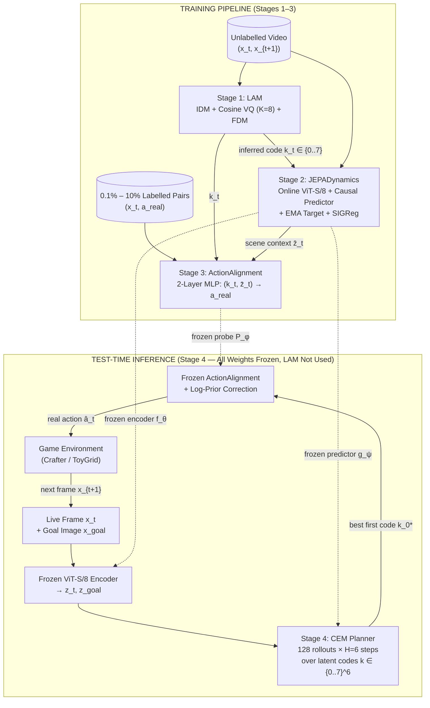

# `latent-play` — Learning Actionable World Models from Unlabelled Gameplay

[](https://github.com/rivas-vega/latent-play/actions/workflows/ci.yml)
[](https://www.python.org/)
[](https://pytorch.org/)
[](LICENSE)
[](report/main.pdf)

> **Research Question:** *Can a Joint-Embedding Predictive Architecture (JEPA) learn a controllable, non-collapsing world model purely from unlabelled gameplay video—and how few real action labels are needed to align its discovered latent actions for closed-loop planning?*

<p align="center">
  
</p>

<p align="center">
  <em><b>Closed-Loop Latent Planning in Crafter (Zero Pixel Reconstruction at Test Time):</b> Starting at tile <code>(32, 32)</code> (left), the agent observes live frames <code>x_t</code> and a target visual goal <code>x_goal</code> at tile <code>(35, 29)</code> (right). At every step, it encodes both into <code>ViT-S/8</code> representation space, rolls out 128 candidate 6-step trajectories over the 8 discovered latent codes using the Cross-Entropy Method (CEM), translates the best immediate code <code>k_0*</code> into a real Crafter control via a few-shot alignment probe, and reaches the goal in 6 steps.</em>
</p>

---

## 1. How It Works in 30 Seconds

`latent-play` separates **learning how the world changes** (from 100% unlabelled video) from **learning what the controller buttons are called** (from a tiny labelled subset):

1. **Stage 1 — Latent Action Model (`LAM`, Training, 0% labels):** An inverse-forward model watches consecutive video frames $(x_t, x_{t+1})$ and compresses whatever caused the visual transition into one of **$K=8$ discrete latent action codes** $k_t \in \{0..7\}$ via a Cosine Vector Quantizer (`VQ`).
2. **Stage 2 — Isotropic JEPA World Model (`JEPADynamics`, Training, 0% labels):** With `LAM` frozen as a pseudo-labeler, a `ViT-S/8` encoder and causal Spatio-Temporal predictor learn to predict the next frame's latent representation $\hat{z}_{t+1}$ from $(z_t, k_t)$, regularized by **SIGReg** (*Sketched Isotropic Gaussian Regularization*) so representations never collapse.
3. **Stage 3 — Few-Shot Action Alignment (`ActionAlignment`, Training, 0.1%–10% labels):** With both `LAM` and `JEPA` frozen, a lightweight 2-layer MLP (`~1.6K`–`27K` parameters) learns to translate `(latent code k_t, scene embedding z̄_t) → real environment action a_t` using a small handful of labelled frames.
4. **Stage 4 — Closed-Loop Latent MPC (`CEMPlanner`, Test-Time Inference, all weights frozen):** At test time, **`LAM` is no longer needed**. Given live frame $x_t$ and goal image $x_{\text{goal}}$, `CEM` searches over sequences of the **8 latent codes** entirely inside `JEPA`'s latent space, picks the best first code $k_0^*$, and passes it to `ActionAlignment` to execute a real game action.

---

## 2. Architecture: Training vs. Test-Time Inference



### Summary Table

| Stage | Module | Input → Output | What Is Trained | Loss / Objective |
|---|---|---|---|---|
| **1. Action Discovery** | `LAM` ([`lam.py`](latent_play/models/lam.py), [`vq.py`](latent_play/models/vq.py)) | Frame clip $(x_{t-1}, x_t, x_{t+1}) \to$ discrete code $k_t \in \{0..7\}$ + reconstructed $\hat{x}_{t+1}$ | IDM encoder, Cosine VQ codebook ($K=8$), FDM pixel decoder (`1.68M`–`7.65M` params) | Motion-weighted pixel MSE + VQ commitment + batch entropy regularization |
| **2. World Model** | `JEPADynamics` ([`dynamics.py`](latent_play/models/dynamics.py), [`jepa.py`](latent_play/losses/jepa.py)) | Frame $x_t$ + frozen `LAM` code $k_t \to$ predicted next latent $\hat{z}_{t+1} \in \mathbb{R}^{64\times D}$ | Online `ViT-S/8` $f_\theta$, action table $E_a$, causal predictor $g_\psi$ (`2.05M`–`14.8M` params); Target $f_{\bar{\theta}}$ via EMA | Latent $L_1$ prediction error vs. stop-grad target + `SIGReg` isotropy + `VICReg` variance hinge |
| **3. Action Alignment** | `ActionAlignment` ([`alignment.py`](latent_play/planning/alignment.py)) | Latent code $k_t$ + pooled state $\bar{z}_t \to$ distribution over real buttons $P_\phi(a \mid k_t, \bar{z}_t)$ | 2-layer MLP probe $\phi$ (`1.6K`–`27K` params) on `0.1%–10%` labels (`LAM` & `JEPA` frozen) | Cross-entropy against ground-truth action $a_{\text{real}}$ |
| **4. Latent Planning** | `CEMPlanner` ([`cem.py`](latent_play/planning/cem.py)) | Current & goal frames $(x_t, x_{\text{goal}}) \to$ executed environment action $\hat{a}_t$ | **Nothing** (test-time optimization over $k_{0..H-1} \in \{0..7\}^H$ using frozen `JEPA` + probe) | Minimizes latent $L_1$ distance $\|\hat{z}_{t+H} - z_{\text{goal}}\|_1$ across $M=128$ rollouts |

### Technical Details by Stage (Click to Expand)

<details>
<summary><b>Stage 1 Details: What is embedded & how <code>LAM</code> prevents codebook collapse</b></summary>

- **Spatial Patch Tokenization (`PatchEmbed`):** Each $64\times 64$ RGB frame is split by a $8\times 8$ convolution (stride 8) into **$N_p = 64$ spatial patch tokens** of dimension $D$ ($D=128$ on ToyGrid, $D=256$ on Crafter) with 2D positional encodings.
- **Inverse Dynamics & Motion Pooling:** Tokens pass through 4 causal Spatio-Temporal (`STBlock`) layers. To isolate controllable movement from static backgrounds, `LAM` computes the temporal feature difference $\Delta h_t = h_{t+1} - h_t$ and pools across the 64 patches using learned spatial motion attention to obtain a compact vector $u_t \in \mathbb{R}^{32}$.
- **Anti-Collapse Cosine VQ ($K=8$):** Standard VQ bottlenecks often collapse to a single code on correlated video frames. We combine (1) batch-mean centering $\tilde{u}_t = u_t - \bar{u}$, (2) $\ell_2$-normalized cosine nearest-neighbor lookup $k_t = \arg\min_k \|\hat{u}_t - \hat{e}_k\|_2$, and (3) differentiable batch-entropy regularization $\mathcal{L}_{\text{ent}} = H(p \mid \tilde{u}_t) - H(\bar{p})$ so all $8/8$ codes remain active.
- **Motion-Weighted Forward Decoder:** The decoder receives only the current frame $x_t$ and the quantized code $e_{k_t}$, predicting a pixel residual $\hat{x}_{t+1} = \text{clamp}(x_t + \Delta\hat{x}_t, 0, 1)$ weighted by local frame change $w = 1 + 10\|x_{t+1} - x_t\|_1$.
</details>

<details>
<summary><b>Stage 2 Details: How the <code>JEPA</code> predictor is trained & exactly where <code>SIGReg</code> acts</b></summary>

- **Online vs. Target Encoders:** The online encoder $f_\theta$ (`ViT-S/8`, $D=192$ on ToyGrid, $D=384$ on Crafter) maps $x_t$ to 64 patch tokens $z_t \in \mathbb{R}^{64\times D}$. The target encoder $f_{\bar{\theta}}$ maps $x_{t+1}$ to $z_{t+1}^{\text{tgt}} = \text{sg}[f_{\bar{\theta}}(x_{t+1})]$ with **stop-gradient** and Exponential Moving Average weight updates ($\bar{\theta} \leftarrow \tau\bar{\theta} + (1-\tau)\theta$, $\tau \in [0.996, 1.0]$).
- **Where `SIGReg` and `VICReg` Act:** Both regularizers act **directly on the online encoder's representations $z_t$**:
  - **SIGReg ($\lambda = 0.05$):** Projects the batch of online tokens onto $M=64$ random 1D unit directions $u^{(m)} \sim \mathbb{S}^{D-1}$ (Cramér-Wold theorem) and applies the univariate **Epps-Pulley** characteristic-function test $T_{\text{EP}}(Z u^{(m)})$ to drive $z_t \to \mathcal{N}(0, I_D)$ in $O(N \cdot M)$ time without $D\times D$ covariance inversion.
  - **VICReg Variance Hinge ($\lambda = 0.02$):** Penalizes $\max(0, 1 - \sqrt{\text{Var}(z_d)})$ per channel.
- **Causal Residual Predictor $g_\psi$:** Looks up the frozen `LAM` code $k_t$ in a trainable action embedding table $E_a \in \mathbb{R}^{8\times D}$, adds $E_a(k_t)$ to all 64 spatial tokens of $z_t$, runs 4–6 causal `STBlock` layers, and predicts the residual transition $\hat{z}_{t+1} = z_t + \Delta z_\psi(z_{0..t}, k_{0..t})$ trained via $L_1$ loss $\|\hat{z}_{t+1} - \text{sg}[z_{t+1}^{\text{tgt}}]\|_1$.
</details>

<details>
<summary><b>Stages 3 & 4 Details: Few-Shot Alignment & Dual Action Loops (Inner CEM vs. Outer MPC)</b></summary>

- **Why Context Conditioning Matters (`ActionAlignment`):** Because ego-centric effects depend on the player's surroundings (e.g., pressing `move_up` against a rock or water shoreline produces zero camera shift), our probe $P_\phi(a_{\text{real}} \mid k_t, \bar{z}_t)$ takes both the one-hot latent code $k_t \in \{0..7\}$ and the mean-pooled scene embedding $\bar{z}_t \in \mathbb{R}^D$. At inference, it applies a log-prior correction ($\gamma = 0.5$) to counter action frequency imbalance:
  $$\hat{a}_t = \arg\max_{a} \big(\log P_\phi(a \mid k_t, \bar{z}_t) - 0.5\log \hat{P}(a)\big)$$
- **Inner Mental Loop (`CEMPlanner` inside `JEPA`):** Before taking a single step in the game, the planner encodes $z_t = f_\theta(x_t)$ and $z_{\text{goal}} = f_\theta(x_{\text{goal}})$. Across $I=4$ iterations, it samples $M=128$ candidate 6-step latent code sequences $k^{(m)} \in \{0..7\}^6$, unrolls $\hat{z}_{t+1..t+6}$ using $g_\psi$, ranks candidates by latent $L_1$ distance to $z_{\text{goal}}$, refits the categorical distribution to the top $E=16$ elites, and emits the best immediate latent code $k_0^*$.
- **Outer Physical Loop (Environment MPC):** `ActionAlignment` translates $k_0^*$ into $\hat{a}_t$, the game steps to $x_{t+1}$, and planning repeats in receding-horizon fashion.
</details>

---

## 3. Experimental Results Summary

All experiments were executed end-to-end on an NVIDIA A100-SXM4-40GB (`30,000` steps per stage on `Crafter`, `2,000` steps on `ToyGridEnv`, 3 evaluation seeds). Full tables, confusion matrices, and per-seed breakdowns are available in **[`docs/RESULTS.md`](docs/RESULTS.md)** and **[`report/main.pdf`](report/main.pdf)**.

| Benchmark & Task | Metric | Unlabelled / Random Baseline | `latent-play` (`1%` Labels) | `latent-play` (`10%` Labels) | Action Oracle (`100%` True Labels) |
|---|---|---:|---:|---:|---:|
| **`Crafter` Stage 1 (`LAM`)** | Codebook Usage / $\Delta\text{PSNR}_{\text{ctrl}}$ | `1/8` (`0.0 dB`) | **`8/8` (`+10.05 dB`)** | **`8/8` (`+10.05 dB`)** | — |
| **`Crafter` Stage 2 (`JEPA`)** | Effective Rank / 8-Step Latent $L_1^\dagger$ | Collapsed (`1.0`) | **`39.1` / `0.1523`** | **`39.1` / `0.1523`** | `37.8` / `0.2003` |
| **`Crafter` Stage 3 (`Probe`)** | Action Alignment Accuracy (17 classes) | `5.9%` (uniform) | **`44.7% ± 0.9%`** | **`45.6% ± 0.1%`** | `100%` (ground-truth) |
| **`Crafter` Stage 4 (`CEM MPC`)** | Closed-Loop Goal Navigation (Mean ± SD)$^\ddagger$ | `6.7% ± 2.7%` | **`14.4% ± 4.2%`** | **`15.6% ± 1.6%`** | `10.0% ± 4.7%` |
| **`ToyGrid` Stage 4 (`CEM MPC`)** | Closed-Loop Goal Navigation (Mean ± SD)$^\ddagger$ | `12.0% ± 0.0%` | **`22.7% ± 4.9%`** | **`24.0% ± 3.3%`** | `28.0% ± 3.3%` |
| **`ToyGrid` Zero-Shot VoE** | Physical Violation Detection AUROC | `0.5000` | **`0.8712` (`1.77×`)** | **`0.8712` (`1.77×`)** | — |

> **Methodological Notes on Interpreting the Numbers:**
> - **$\dagger$ Cross-Model Latent $L_1$ Error:** Although both `LAM`-JEPA and `Oracle`-JEPA are constrained to unit variance and isotropic Gaussian marginals via `SIGReg`, each trains its own encoder $f_\theta$. Lower latent $L_1$ error in `LAM`-JEPA (`0.1523` vs. `0.2003`) reflects higher *internal predictability* of visual motion (since `LAM` assigns distinct codes to realized camera motion vs. blocked actions) rather than a direct pixel-space comparison.
> - **$\ddagger$ Statistical Variance in Closed-Loop Planning:** Closed-loop MPC is evaluated over 25–30 episodes across 3 seeds (`SD ≈ 2%–10%`, with `0.1%` labels showing high variance on Crafter at `12.2% ± 10.3%`). Differences within the `10%–16%` band on Crafter or `23%–28%` on ToyGrid are within sampling noise. The key empirical takeaway is that **alignment probe accuracy saturates by `1%` supervision (`~2.6k` frames)** and reaches **the same closed-loop planning regime as a world model trained with 100% ground-truth action labels**, roughly doubling the success rate of an unguided random walk.

<p align="center">
  
  
</p>

---

## 4. Quickstart & Reproducibility

```bash
# 1. Install dependencies with uv (CPU or CUDA)
uv sync --extra dev --extra crafter
uv run pytest -q

# 2. Run the complete ToyGridEnv pipeline (Data -> LAM -> JEPA+SIGReg -> Alignment Sweep -> Plots)
bash scripts/run_all_toy.sh

# 3. Or run on Crafter (or open notebooks/latent_play_colab.ipynb on Google Colab GPU)
bash scripts/run_all_crafter.sh
```

```text
latent-play/
├── latent_play/
│   ├── data/          # ToyGridEnv, Crafter wrapper, memmap datasets with zero-leakage action masking
│   ├── models/        # PatchEmbed, STBlock, Cosine VectorQuantizer, LatentActionModel, JEPADynamics
│   ├── losses/        # Epps-Pulley SIGReg (Cramér-Wold 1D projections) + VICReg variance/cov losses
│   └── planning/      # Contextual ActionAlignment probe + Receding-Horizon CEMPlanner
├── scripts/           # CLI entrypoints (collect_data, train_lam, train_dyn, eval_planning, eval_voe)
├── docs/RESULTS.md    # Full experimental breakdown, confusion matrices, and statistical caveats
└── report/main.pdf    # 7-page technical report (LaTeX source in report/main.tex)
```

---

## 5. Motivation, Prior Work Connections & References

Standard action-conditioned world models (`V-JEPA 2-AC`, `DreamerV3`) assume every training frame is paired with a ground-truth action label $a_t$ (`keypress`, `joint torque`). Yet 99.9% of internet gameplay and real-world video is **unlabelled**. Conversely, Latent Action Models (`Genie`, `LAPA`) discover discrete latent actions from unlabelled video, but optimize pixel-reconstruction or autoregressive token objectives rather than **representation-space predictive dynamics** with explicit anti-collapse guarantees. `latent-play` bridges both lines of work in a single minimal codebase (`~1,500` lines of PyTorch), extending our prior work on representation collapse in **I-JEPA** (*B.Sc. Thesis, UPM 2025*) and zero-shot physical surprise scoring in [**`vjepa2-physics-scorer-poc`**](https://github.com/rivas-vega/vjepa2-physics-scorer-poc).

### References
1. **V-JEPA 2:** M. Assran, A. Bardes, D. Fan, Q. Garrido, R. Howes, M. Muckley, A. Rizvi, C. Roberts, K. Sinha, A. Zholus, *et al.* *"V-JEPA 2: Self-Supervised Video Models Enable Understanding, Prediction and Planning."* `arXiv:2506.09985`, 2025.
2. **LeJEPA & SIGReg:** R. Balestriero and Y. LeCun. *"LeJEPA: Provable and Scalable Self-Supervised Learning Without the Heuristics."* `arXiv:2511.08544`, 2025. *(Introduces **Sketched Isotropic Gaussian Regularization — SIGReg** via Cramér-Wold 1D projections and the Epps-Pulley test).*
3. **Genie:** J. Bruce, M. Dennis, A. Edwards, J. Parker-Holder, Y. Shi, E. Hughes, M. Lai, A. Mavalankar, R. Steigerwald, C. Apps, *et al.* *"Genie: Generative Interactive Environments."* ICML, 2024 (`arXiv:2402.15391`).
4. **LAPA:** S. Ye, J. Jang, B. Jeon, S. Joo, J. Yang, B. Peng, A. Mandlekar, R. Tan, Y.-W. Chao, B. Y. Lin, *et al.* *"Latent Action Pretraining from Videos."* ICLR, 2025 (`arXiv:2410.11758`).
5. **I-JEPA:** M. Assran, Q. Duval, I. Misra, P. Bojanowski, P. Vincent, M. Rabbat, Y. LeCun, and N. Ballas. *"Self-Supervised Learning from Images with a Joint-Embedding Predictive Architecture."* CVPR, 2023.
6. **VICReg:** A. Bardes, J. Ponce, and Y. LeCun. *"VICReg: Variance-Invariance-Covariance Regularization for Self-Supervised Learning."* ICLR, 2022.
7. **Crafter:** D. Hafner. *"Benchmarking the Spectrum of Agent Capabilities."* NeurIPS Datasets and Benchmarks, 2021.
