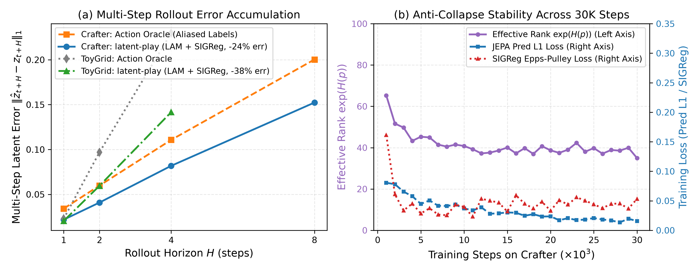

# Detailed Experimental Results & Methodological Notes

This document contains the complete experimental breakdowns, seed-by-seed statistics, confusion matrices, and methodological caveats for `latent-play`. For the concise overview, see the main [`README.md`](../README.md) or the compiled paper [`report/main.pdf`](../report/main.pdf).

---

## 1. Stage 1: Unsupervised Latent Action Discovery (`LAM`)

During Stage 1, `LAM` is trained with **0% action labels** (`action = -1`). To verify that the $K=8$ discrete codes capture controllable transitions rather than background noise, we evaluate:
- **Controllability ($\Delta\text{PSNR}_{\text{ctrl}}$):** The gain in next-frame reconstruction PSNR when decoding $\hat{x}_{t+1}$ with the inferred code $k_t$ versus a random code $k_{\text{rand}} \sim \text{Uniform}(0..7)$.
- **Codebook Usage & Perplexity:** Number of active codes out of $K=8$ and $\exp(H(\bar{p}))$.
- **Action Purity & NMI:** Post-hoc alignment against ground-truth environment actions on the validation split.

| Dataset | Steps | Batch | Active Codes | Perplexity | Recon PSNR | $\Delta\text{PSNR}_{\text{ctrl}}$ | Action Purity (Visible) | NMI (Visible) |
|---|---:|---:|---:|---:|---:|---:|---:|---:|
| **`ToyGridEnv`** | 2,000 | 64 | `8 / 8` | `7.61` | `23.51 dB` | **`+2.28 dB`** | `68.8%` | `0.379` |
| **`Crafter`** | 30,000 | 128 | `8 / 8` | `7.12` | `31.62 dB` | **`+10.05 dB`** (`+9.23 dB` @ 30k) | `41.1%` (across 17 actions) | `0.159` |

### Semantic Specialization on `Crafter` (`8 × 17` Contingency Matrix)

Inspecting [`checkpoints/lam_crafter/confusion.json`](../checkpoints/lam_crafter/confusion.json) on the held-out validation windows shows how the 8 unsupervised codes partition Crafter's 17 discrete controls:
- **Code 6 (`95.6%` locomotion):** `917 / 959` assigned transitions are cardinal movements (`move_left`, `move_right`, `move_up`, `move_down`), with only `1` `noop`.
- **Code 7 (`94.7%` locomotion):** `818 / 864` transitions are cardinal movements (primarily `move_up` and `move_right`).
- **Code 5 (`80.3%` locomotion):** `536 / 668` transitions are cardinal movements.
- **Code 1 (screen-darkening transitions):** Isolates `sleep` episodes (`87` occurrences).
- **Codes 0, 2, 3, 4 (stationary / interaction transitions):** Partition `noop`, `do`, blocked movements against obstacles, and crafting/placement attempts where ego-centric camera translation is zero.

  

---

## 2. Stage 2: JEPA World Model Stability & Multi-Step Rollouts

In Stage 2, `JEPADynamics` trains an online `ViT-S/8` encoder $f_\theta$, an EMA target encoder $f_{\bar{\theta}}$, and a causal spatio-temporal predictor $g_\psi$ conditioned on the frozen Stage-1 `LAM` codes $k_t \in \{0..7\}$. To prevent representation collapse without $O(D^2)$ covariance matrices, **Sketched Isotropic Gaussian Regularization (`SIGReg`)** (Balestriero & LeCun, 2025) projects online representations onto $M=64$ random unit directions and applies the univariate Epps-Pulley normality test alongside a VICReg variance hinge.

| Environment | Conditioning | 1-Step Latent $L_1$ | 2-Step Latent $L_1$ | 4-Step Latent $L_1$ | 8-Step Latent $L_1$ | Effective Rank $\exp(H(p))$ |
|---|---|---:|---:|---:|---:|---:|
| **`ToyGridEnv`** | **LAM ($K=8$, 0% labels)** | `0.0258` | `0.0365` | `0.0568` | — | `46.5` (out of 192) |
| **`ToyGridEnv`** | **Oracle ($A=5$, 100% labels)** | `0.0431` | `0.0598` | `0.0921` | — | `44.9` (out of 192) |
| **`Crafter`** | **LAM ($K=8$, 0% labels)** | `0.0680` | `0.0920` | `0.1233` | `0.1523` | `39.1` (`[35.0, 42.3]` over 30k steps) |
| **`Crafter`** | **Oracle ($A=17$, 100% labels)** | `0.0882` | `0.1190` | `0.1597` | `0.2003` | `37.8` |

> [!IMPORTANT]
> **Methodological Caveat on Cross-Model Latent $L_1$ Comparisons:**
> Each model (`LAM`-conditioned JEPA vs. `Oracle`-conditioned JEPA) trains its own online/target encoder pair $(f_\theta, f_{\bar{\theta}})$. Although both models are constrained to unit per-channel standard deviation ($\text{Std}(z_d) \ge 1$) and isotropic Gaussian marginals via `SIGReg` ($\lambda=0.05$), latent $L_1$ errors are measured in each model's own representation space. Therefore, lower latent $L_1$ error in the `LAM`-conditioned model reflects higher *internal predictability* of visual transitions (since `LAM` assigns distinct codes to visually realized motion vs. blocked stationary actions), and should always be interpreted together with downstream closed-loop planning success (Section 3).

  

---

## 3. Stages 3 & 4: Label-Efficiency Sweep & Closed-Loop CEM Planning

To evaluate how many real action labels are needed to turn the unsupervised world model into a controller, we freeze `LAM` and `JEPADynamics`, fit the lightweight `ActionAlignment` probe $P_\phi(a_{\text{real}} \mid k_t, \bar{z}_t)$ on a fraction $\alpha \in \{0.1\%, 1\%, 5\%, 10\%, 100\%\}$ of labelled transitions, and run closed-loop Model Predictive Control (`CEMPlanner`, $M=128$ rollouts, $I=4$ iterations, horizon $H=6$) over 3 random seeds (`25` episodes/seed on `ToyGridEnv`, `30` episodes/seed on `Crafter`).

| Environment | Method | Label Fraction $\alpha$ | Approx. Labelled Frames | Alignment Probe Acc. | Closed-Loop Goal Success (Mean ± SD) | Final Manhattan Dist. to Goal |
|---|---|---:|---:|---:|---:|---:|
| **`ToyGridEnv`** | Random Walk Baseline | `0%` | `0` | — | `12.0% ± 0.0%` | `2.65` |
| **`ToyGridEnv`** | **`latent-play` (LAM + JEPA)** | `0.1%` | `~92` | `46.5% ± 3.9%` | `28.0% ± 6.5%` | `2.45` |
| **`ToyGridEnv`** | **`latent-play` (LAM + JEPA)** | `1.0%` | `~921` | `48.8% ± 0.4%` | `22.7% ± 4.9%` | `2.51` |
| **`ToyGridEnv`** | **`latent-play` (LAM + JEPA)** | `5.0%` | `~4,606` | `51.6% ± 0.1%` | `22.7% ± 1.9%` | `2.49` |
| **`ToyGridEnv`** | **`latent-play` (LAM + JEPA)** | `10.0%` | `~9,213` | `52.0% ± 0.1%` | `24.0% ± 3.3%` | `2.48` |
| **`ToyGridEnv`** | **`latent-play` (LAM + JEPA)** | `100.0%` | `92,132` | `52.2% ± 0.1%` | `22.7% ± 6.8%` | `2.49` |
| **`ToyGridEnv`** | Action Oracle JEPA | `100.0%` | `92,132` | `100%` (ground-truth) | `28.0% ± 3.3%` | `2.38` |
| **`Crafter`** | Random Walk Baseline | `0%` | `0` | — | `6.7% ± 2.7%` | `4.12` |
| **`Crafter`** | **`latent-play` (LAM + JEPA)** | `0.1%` | `~260` | `38.1% ± 2.7%` | `12.2% ± 10.3%` | `3.58` |
| **`Crafter`** | **`latent-play` (LAM + JEPA)** | `1.0%` | `~2,598` | `44.7% ± 0.9%` | `14.4% ± 4.2%` | `3.49` |
| **`Crafter`** | **`latent-play` (LAM + JEPA)** | `5.0%` | `~12,994` | `45.3% ± 0.3%` | `12.2% ± 4.2%` | `3.52` |
| **`Crafter`** | **`latent-play` (LAM + JEPA)** | `10.0%` | `~25,988` | `45.6% ± 0.1%` | `15.6% ± 1.6%` | `3.41` |
| **`Crafter`** | **`latent-play` (LAM + JEPA)** | `100.0%` | `259,887` | `45.5% ± 0.1%` | `10.0% ± 2.7%` | `3.64` |
| **`Crafter`** | Action Oracle JEPA | `100.0%` | `259,887` | `100%` (ground-truth) | `10.0% ± 4.7%` | `3.61` |

> [!NOTE]
> **Statistical Interpretation of the Label-Efficiency Sweep:**
> Because closed-loop evaluation runs 25–30 stochastic episodes per seed across 3 seeds, standard deviations range between `±1.6%` and `±10.3%` (in particular, the `0.1%` Crafter setting has high variance across seeds: `12.2% ± 10.3%`). Consequently, small differences between `1%`, `5%`, `10%`, and the `100%` Action Oracle (`12.2%–15.6%` vs. `10.0%` on Crafter, or `22.7%–28.0%` vs. `28.0%` on ToyGrid) are **statistically indistinguishable within sampling noise**. The robust empirical finding is that **probe accuracy saturates by `1%` supervision (`~2.6k` labels on Crafter, `~920` on ToyGrid)** and reaches the **same closed-loop planning regime as a world model trained with 100% ground-truth action labels**, roughly doubling the success rate of an unguided random walk (`~12–15%` vs `6.7%` on Crafter; `~23–28%` vs `12.0%` on ToyGrid).

  

---

## 4. Physical Violation-of-Expectation (VoE) Surprise Scoring

Following the zero-shot physical plausibility protocol of `V-JEPA 2`, we evaluate whether the unsupervised `JEPADynamics` world model assigns higher latent prediction error $\mathcal{S}_t = \|\hat{z}_{t+1} - z_{t+1}^{\text{tgt}}\|_1$ to trajectories containing an injected physical violation than to natural plausible trajectories ([`outputs/voe_metrics.json`](../outputs/voe_metrics.json)):

| Environment & Violation Type | Plausible Surprise $\mathcal{S}_{\text{plausible}}$ | Violated Surprise $\mathcal{S}_{\text{violated}}$ | Surprise Ratio $R = \mathcal{S}_{\text{violated}} / \mathcal{S}_{\text{plausible}}$ |
|---|---:|---:|---:|
| **`Crafter` — Spatial Teleportation** (sudden frame jump) | `0.0209` | `0.2862` | **`15.25×`** |
| **`Crafter` — Object Disappearance** (entity patched out) | `0.0209` | `0.9016` | **`52.91×`** |
| **`Crafter` — Action Contradiction** (opposing latent code) | `0.0209` | `0.0397` | **`1.83×`** |
| **`ToyGridEnv` — Combined Physical Violations** (AUROC `0.8712`) | `0.0251` | `0.0445` | **`1.77×`** |
